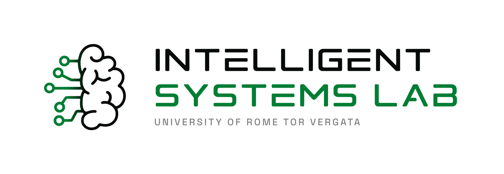
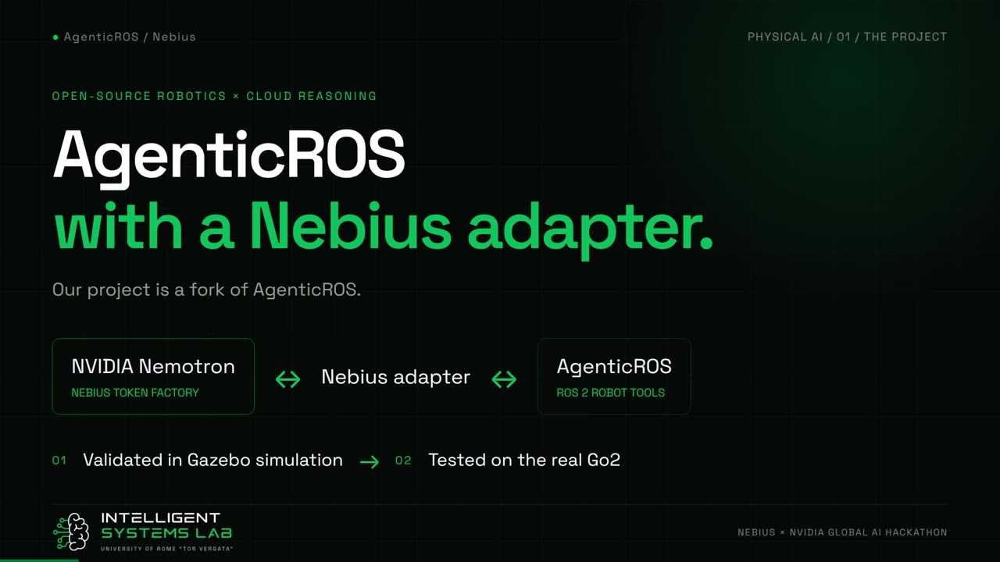
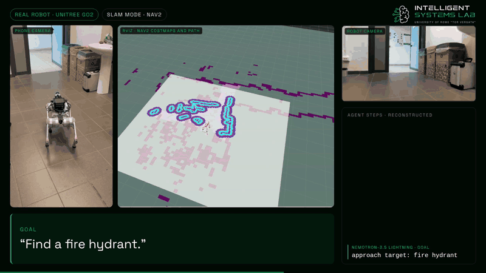
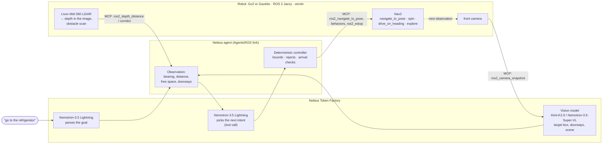
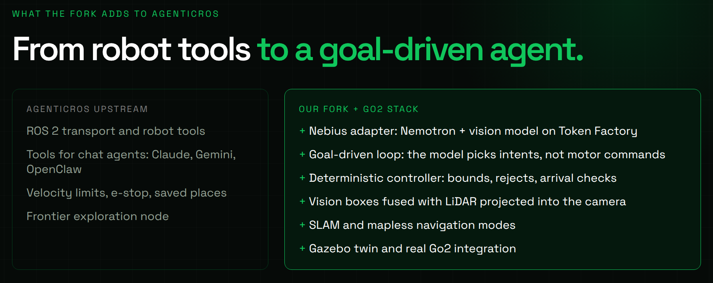
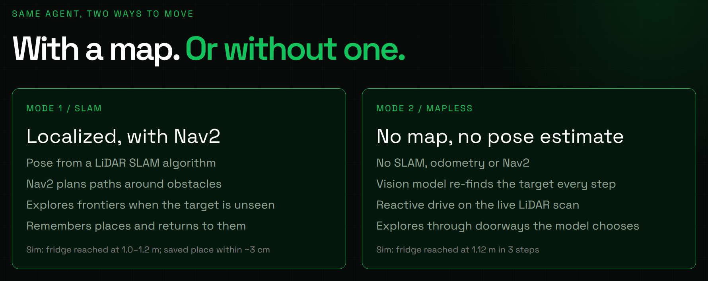
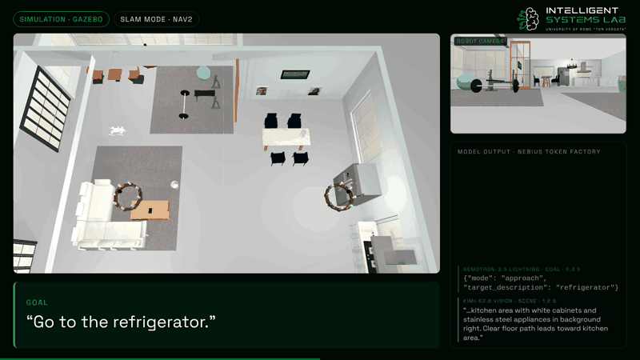

<p align="center">
  <picture>
    <source media="(prefers-color-scheme: dark)" srcset="assets/readme/isl-logo-dark.svg">
    
  </picture>
</p>

<h1 align="center">AgenticROS × Nebius: a Unitree Go2 that walks to what you ask for</h1>

<p align="center">
  <b>NVIDIA Nemotron on Nebius Token Factory turns a plain-language goal into safe, validated motion of a real quadruped.</b><br>
  Nebius × NVIDIA Global AI Hackathon · <b>Physical AI track</b>
</p>

<p align="center">
  
  
  
  
  
</p>

<p align="center">
  <a href="https://youtu.be/REPLACE_WITH_VIDEO_ID"></a><br>
  <sub>▶ <a href="https://youtu.be/REPLACE_WITH_VIDEO_ID">Watch the demo video</a> (under 3 minutes, more than 1 minute on the real robot)</sub>
</p>

<p align="center">
  <br>
  <sub>The real Go2, asked to <i>“find a fire hydrant”</i>: it scans the room and doesn't find it, crosses the door with Nav2, sees the hydrant at the end of the corridor and stops in front of it (2.5× speed).</sub>
</p>

## The problem

Telling a legged robot to *"go to the refrigerator"* in a building it has never mapped still takes a robotics engineer: someone has to write the mission, mark the goal on a map, or train a policy for that place. Service, inspection and assistive robots need to take goals in plain language from the people around them. They also need to stay safe when the model behind them is wrong, slow, or offline.

We built that on top of [AgenticROS](https://github.com/agenticros/agenticros), the open-source runtime that exposes a ROS 2 robot to AI agents as tools. **NVIDIA Nemotron**, served by **Nebius Token Factory**, reads the goal and chooses each next step. A vision model on the same endpoint finds the target in the camera image, and the robot's LiDAR measures how far away it is. A deterministic controller checks every step before the robot moves. The same code runs in Gazebo and on a real Unitree Go2 EDU.

## How it works



1. **Goal.** Nemotron turns the request into a task: approach an object, describe the scene, move, go back to a saved place, or stop.
2. **Perception.** At every step the agent takes a camera frame through an AgenticROS MCP tool. The vision model on Token Factory returns the target's bounding box, the open doorways and a short description of the scene. LiDAR points projected into the image give the distance inside the box and the free space ahead. If the depth doesn't fit the box (something closer is covering the target), the distance counts as unknown and the robot can't declare arrival.
3. **Decision.** Nemotron picks a semantic intent with a tool call: `search`, `face_target`, `approach_target`, `explore` or `finish`.
4. **Validation.** The controller turns the intent into geometry and clamps it, or rejects it, with a reason Nemotron sees on the next step. It enforces the stop distance, the free-space and obstacle limits, re-checks a sighting on a crop of the image, and refuses an arrival when an object fills the frame.
5. **Motion.** Every motion is a Nav2 goal or behavior (`spin`, `drive_on_heading`, `backup`), never a raw velocity command from the model. The AgenticROS e-stop cancels it at any time. The loop repeats until arrival, failure or the step/time limit.

<p align="center">
  
</p>

### Two ways to move

| | **SLAM + Nav2** (this branch, `master`) | **Mapless** (branch [`mapless`](../../tree/mapless)) |
|---|---|---|
| Localization | LiDAR SLAM pose (EKF + LIO-SAM on the robot, its stand-in in simulation) | none: no map, no odometry, no pose estimate |
| How it reaches the target | Nav2 plans around obstacles, explores frontiers when the target is not in view, remembers places (*"remember this place as kitchen"*, *"go back to the kitchen"*) | the vision model finds the target again at every step, and a reactive drive on the live LiDAR scan avoids obstacles; it explores through the doorways the model chooses |
| Simulation result | fridge reached at 1.0–1.2 m; saved places reached within ~3 cm | fridge reached at 1.12 m in 3 steps |

<p align="center">
  
</p>

### Safety comes from the code

The language model only chooses *what* to do next. Limits, geometry and arrival checks are deterministic:

- speed limits from the AgenticROS config, a stop distance from the target (1 m by default), and Nav2's collision monitor on the LiDAR scan;
- a sighting must be confirmed on a crop of the image, and an object that fills the frame up close doesn't count as an arrival;
- every decision has a 10 s budget. If Nemotron Lightning errors or times out, the next calls go to Nemotron Nano, and failing that a deterministic policy decides, so the robot never waits minutes for an answer. The vision model has its own fallback (Kimi-K2.6 → Nemotron-3.5-Super-VL);
- `Ctrl-C` or `ros2_estop` cancels the running Nav2 goal at once. Before calling any model, the agent checks that the sensors are publishing.

## NVIDIA models on Nebius Token Factory

Every model call goes through Token Factory's OpenAI-compatible API ([`packages/agenticros-nebius`](tools/agenticros/packages/agenticros-nebius/src)). The robot's Jetson only runs ROS: all inference happens on Token Factory.

| Role | Model | Notes |
|---|---|---|
| Goal parsing and every step decision (tool calls) | `nvidia/Nemotron-3_5-Lightning` | ~0.3–0.4 s per decision when the endpoint is healthy |
| Fallback for decisions and parsing | `nvidia/NVIDIA-Nemotron-3-Nano-30B-A3B` | `enable_thinking: false`, ~0.8 s; takes over after an error or a 10 s timeout, for the next 5 calls |
| Vision: target box, doorways, scene | `moonshotai/Kimi-K2.6` (default) | boxes as 0–1 fractions in ~1 s; `chat_template_kwargs: {thinking: false}` |
| Vision fallback; default vision model on the `mapless` branch | `nvidia/Nemotron-3.5-Super-VL` | boxes on a 0–1000 grid, `enable_thinking: false`: ~1 s instead of 2 s, same boxes |

To use only NVIDIA models, set `NEBIUS_VISION_MODEL=nvidia/Nemotron-3.5-Super-VL`. Each vision model has a profile in [`vision.ts`](tools/agenticros/packages/agenticros-nebius/src/vision.ts) with its grounding format, thinking switch and JSON-schema support.

**How Token Factory helped.** One endpoint and one API key serve both reasoning and vision, so trying a model is a matter of changing one variable. Before choosing, we ran about ten vision models (Kimi-K2.6, Nemotron-3.5-Super-VL, MiniCPM-V-4.5, DeepSeek, Qwen, GLM and others) on the same simulation frames with ground truth. On 7 frames both Nemotron-3.5-Super-VL and Kimi-K2.6 found every target, with median bearing errors of 1.1° and 2.0° at ~1.2 s per frame. The ~1 s vision latency and sub-second decisions keep one perception–decision–motion step at a few seconds, fast enough for a closed loop on a walking robot. `response_format: json_schema` gives the agent structured replies that it can validate.

## Results

Measured in the Gazebo simulation, which has the same sensors, topics, frames and middleware as the real robot (house world, the kitchen is ~8 m from the start), and on the real Go2.

<p align="center">
  <br>
  <sub>Simulation, <i>“go to the refrigerator”</i>: the target is spotted 8 m away, Nav2 covers most of the distance, then the robot looks again, re-aligns and stops (2× speed).</sub>
</p>

| Task | Result |
|---|---|
| *"Go to the refrigerator"*, 8 m away behind a sofa and a dining table | 5–8 steps, one Nav2 goal of ~7 m, arrival at 1.0–1.2 m |
| *"Go to the chair"* (Nemotron decisions in 0.3–0.4 s) | 8 steps, arrival at 0.81 m |
| *"Go to the bed"*, in another room, not visible from the start | 16–18 steps through frontier exploration, arrival at 0.5–1.1 m |
| *"Remember this place as kitchen"* … *"go back to the kitchen"* | Nav2 goals of 7–27 s, arrival ~3 cm from the saved pose |
| *"Turn right 90 degrees and walk one meter"* | 88°, 0.95 m |
| `ros2_estop` during a Nav2 goal | goal cancelled in 12 ms |
| *"Go to the refrigerator"* following the quick start below (Nav2 of this repository, deterministic policy) | 10 steps, arrival at 1.03 m |
| Real Go2, *"find a fire hydrant"* (in the video) | search turn, Nav2 through the door, hydrant spotted at the end of the corridor, stop in front of it |

## Repository layout

| Path | What it is |
|---|---|
| [`tools/agenticros/`](tools/agenticros) | Our fork of AgenticROS (submodule). The Nebius agent is in [`packages/agenticros-nebius/src`](tools/agenticros/packages/agenticros-nebius/src): `agent.ts` (goal loop), `policy.ts` (controller), `perception.ts` and `vision.ts` (vision models and depth), `robot.ts` (MCP tools, Nav2) |
| [`src/go2_sim/`](src/go2_sim) | Gazebo Harmonic simulation of the Go2: `go2_sim.launch.py`, the house world, the bridge with the topics of the real robot, the stand-in for the robot's localization |
| [`src/go2_real/`](src/go2_real) | Runs on the robot and in simulation: LiDAR → depth image aligned with the camera, obstacle scan, reduced cloud for the costmaps, Nav2 without a prior map (`go2_real_nav.launch.py`), RViz |
| [`src/dottorcane_description/`](src/dottorcane_description), [`src/go2_description/`](src/go2_description), [`src/champ*`](src/champ_base) | Robot model and CHAMP locomotion controller used by the simulation |
| [`config/`](config) | AgenticROS config (camera, velocity limits, skills) and the Nav2 skill declaration |
| [`scripts/run_nebius_agent.sh`](scripts/run_nebius_agent.sh) | Starts the agent with the defaults for `GO2_TARGET=sim` (default) or `real` |
| [`docker/`](docker) | Development containers: `container-x86-cudev` (workstation with NVIDIA GPU), `container-x86-dev` (workstation without one) and `container-jetson6` (Jetson Orin on the Go2) |

The workspace follows the layout of [DUA](https://github.com/dotX-Automation/dua-foundation) (Distributed Unified Architecture): ROS 2 Jazzy in Docker containers, one per target.

## Quick start (simulation)

**You need** a Linux host with an NVIDIA GPU, Docker with the NVIDIA container runtime, and a [Nebius Token Factory](https://tokenfactory.nebius.com/) API key.

Without an NVIDIA GPU, use `docker/container-x86-dev` instead of `docker/container-x86-cudev` (container `devcontainer-hackathon-nvidia-x86-dev-1`): same tools, with Gazebo rendering the cameras in software, so the simulation runs slower.

```bash
# on the host
git clone --recurse-submodules https://github.com/IntelligentSystemsLabUTV/hackathon-nvidia.git
cd hackathon-nvidia
cp .env.example .env                       # then set NEBIUS_API_KEY=... in .env
xhost +local:                              # only if you want the Gazebo GUI
cd docker/container-x86-cudev/.devcontainer && DISPLAY=$DISPLAY docker compose up -d
docker exec -it devcontainer-hackathon-nvidia-x86-cudev-1 zsh
```

The container mounts the repository at `~/workspace`. Build it once:

```bash
cd ~/workspace
cbuild                                     # colcon build of the ROS 2 workspace
source install/setup.zsh
(cd tools/agenticros && pnpm install --frozen-lockfile && pnpm build)
./scripts/fetch_house_world.sh             # downloads the house models (AWS RoboMaker Small House)
```

Then start four terminals (`docker exec -it devcontainer-hackathon-nvidia-x86-cudev-1 zsh`, then `cd ~/workspace` in each). As on the real robot, everything runs on `rmw_zenoh_cpp`:

```bash
# 1. zenoh router
zenohd -c /etc/zenoh/rmw/DEFAULT_RMW_ZENOH_ROUTER_CONFIG.json5

# 2. simulation (add gui:=true to watch it, ~3x slower)
RMW_IMPLEMENTATION=rmw_zenoh_cpp ros2 launch go2_sim go2_sim.launch.py world:=house gui:=false

# 3. Nav2 and frontier exploration, the same launch used for the real robot
RMW_IMPLEMENTATION=rmw_zenoh_cpp ros2 launch go2_real go2_real_nav.launch.py use_sim_time:=true

# 4. the agent: one request per run, the answer is printed at the end
./scripts/run_nebius_agent.sh "go to the refrigerator"
./scripts/run_nebius_agent.sh "go to the bed"
./scripts/run_nebius_agent.sh "look around and describe what you see, do not move"
./scripts/run_nebius_agent.sh "remember this place as kitchen"
./scripts/run_nebius_agent.sh "turn right 90 degrees and walk one meter"
```

<details>
<summary><b>What you will see, and useful options</b></summary>

The agent logs each step on stderr:

```text
[Perception] mode=vlm vision=moonshotai/Kimi-K2.6 grounding=box width=1024
[Motion] Nav2 behaviors of / (spin, drive_on_heading, backup): no cmd_vel from the agent
[Step 1] target visible (vlm) bearing -16.9 deg, distance 7.98 m, height 0.2; front clearance 5.68 m
[Decision] approach_target() -> rotate(-17 deg)
[Motion] Nav2 spin -17 deg: succeeded in 1.3 s
...
[Step 10] target visible (vlm) bearing 0.1 deg, distance 1.03 m, height 0.64; front clearance 1 m
[Decision] finish(success) -> finish(success)
```

| Variable | Effect |
|---|---|
| `NEBIUS_VISION_MODEL=nvidia/Nemotron-3.5-Super-VL` | NVIDIA vision model instead of Kimi-K2.6 |
| `NEBIUS_POLICY=auto` | deterministic policy only (Nemotron just parses the goal): a cheap test run |
| `NEBIUS_MAX_STEPS`, `NEBIUS_MAX_SECONDS` | limits of the goal loop (default 30 steps, 300 s) |
| `NEBIUS_PERCEPTION=yolo` | adds a local tiled YOLO detector for COCO targets |

- Stop the robot by hand: `ros2 topic pub --once /dottorcane/go2_control/cmd_vel geometry_msgs/msg/Twist "{}"`.
- Put the robot back at the start without restarting the simulation: `gz service -s /world/default/set_pose --reqtype gz.msgs.Pose --reptype gz.msgs.Boolean --timeout 3000 --req 'name: "dottorcane", position: {x: 0.0, y: 1.5, z: 0.30}, orientation: {x: 0, y: 0, z: 0, w: 1}'`.
- After `Ctrl-C`, Gazebo can stay alive and the next launch reuses the old world: `pkill -9 -f "[g]z sim"` before relaunching. After restarting the simulation, restart Nav2 too.
- Motions are timed in wall-clock seconds and calibrated at real-time factor 1.0 (headless). With the GUI or a slower machine, check `gz topic -e -n 1 -t /stats`.
- Unit tests of the controller and of the vision parsing: `cd tools/agenticros && pnpm --filter @agenticros/nebius test`.

</details>

<details>
<summary><b>On the real Go2</b></summary>

The Go2 EDU carries a Jetson Orin AGX and a Livox Mid-360. It runs the lab's DottorCane stack (bringup, `go2_control`, EKF and LIO-SAM). This repository adds what the agent needs on top of it, with the same topics as the simulation:

```bash
# Jetson (docker/container-jetson6): sensors → depth image, obstacle scan, costmap cloud
ros2 launch go2_real go2_real.launch.py

# workstation (docker/container-x86-cudev): Nav2 and exploration, over zenoh to the robot
ros2 launch go2_real go2_real_nav.launch.py robot:=<jetson-ip>
dottorcane_zenoh <jetson-ip> && dottorcane_arm      # go2_control accepts motion only after the arm action

# agent
GO2_TARGET=real ./scripts/run_nebius_agent.sh "find a fire hydrant"
```

`GO2_TARGET=real` switches the camera height, the motion calibration and the search turn to the real robot's values. Everything else (topics, frames, Nav2 behaviors) is the same as in simulation. RViz over zenoh: `ros2 launch go2_real rviz.launch.py robot:=<jetson-ip>`.

</details>

<details>
<summary><b>Mapless mode</b></summary>

The [`mapless`](../../tree/mapless) branch drops every pose estimate: no SLAM, odometry, IMU integration or Nav2. The vision model (`nvidia/Nemotron-3.5-Super-VL` recommended) finds the target again at every step, and the `ros2_drive_toward` tool drives toward it for at most 3 s, avoiding obstacles on the instantaneous LiDAR scan. When the target is not in the room, the model sees the search turn as one mosaic, picks the doorway to explore and finds it again frame by frame from its own description (a *semantic waypoint*). The branch has its own README with the commands to run it.

</details>

## Built during the hackathon

This repository was created on 23 September 2026, after the submission period opened. The AgenticROS runtime existed before; everything listed here was written for the hackathon, on top of it.

### What we added to AgenticROS

[AgenticROS `main`](https://github.com/agenticros/agenticros) exposes a ROS 2 robot as tools to chat agents (OpenClaw, Claude and Codex over MCP, Gemini): the agent calls them in a conversation, one tool at a time. Our fork ([`IntelligentSystemsLabUTV/agenticros`](https://github.com/IntelligentSystemsLabUTV/agenticros)) adds 17 commits on top of the 4 September 2026 version of `main`: 37 files, ~5,400 lines ([full diff](https://github.com/IntelligentSystemsLabUTV/agenticros/compare/2aa329ba628f5937d5e15270387fa372330d91a7...main)).

| | AgenticROS `main` | Our fork |
|---|---|---|
| Agent | chat adapters: the model drives the tools turn by turn | **`@agenticros/nebius`**, a new package (~3,400 lines + ~750 lines of unit tests): a goal-driven loop where Nemotron on Token Factory picks a semantic intent and a deterministic controller turns it into bounded motion or rejects it; a fallback chain for the reasoning and vision models |
| Perception | camera snapshot, depth at a point, YOLOv8n `find_object` | vision-model profiles (Kimi-K2.6, Nemotron-3.5-Super-VL) returning target boxes, doorways and a scene description; depth inside the box that detects occluding objects; tiled YOLO for small or far targets |
| Robot tools | topics, services, actions, parameters, e-stop, velocity limits, saved places, follow-me | six new MCP tools: `ros2_move_for` (bounded motion, stopped by the e-stop), `ros2_depth_corridor` (3D free space ahead), `ros2_imu_yaw`, `ros2_robot_pose`, `ros2_navigate_to_pose`, `ros2_list_actions` |
| Core | Zenoh, rosbridge, local DDS and WebRTC transports | action goals with feedback, timeout and cancellation on the local transport (Nav2 goals and behaviors stop on `ros2_estop`); places saved per localization session |
| Exploration | frontier exploration node | fixes for a tilted LiDAR: a minimum frontier distance, and recent goals kept across requests so an unreachable frontier isn't picked again |

### Around AgenticROS

- **the robot integration** (`go2_real`): LiDAR-to-camera depth for a robot without a depth camera, obstacle scan, a costmap cloud light enough for Wi-Fi, and Nav2 running on a workstation over zenoh without a prior map;
- **a simulation that matches the robot** (`go2_sim`): same sensors, topics, frames and middleware, so the same commands run in Gazebo and on the Go2;
- **the mapless mode** (branch `mapless`): reactive drive and semantic waypoints;
- **an evaluation of about ten vision models** on Token Factory against ground truth, which chose the perception design (bounding boxes rather than image columns or grids).

## Feedback on Nebius Token Factory and the NVIDIA models

- **Nemotron-3.5-Super-VL** returns boxes on a 0–1000 grid even when asked for 0–1 fractions. It reasons by default (~270 tokens per frame), and `enable_thinking: false` halves the latency with the same boxes. Both facts deserve a line on the model card.
- **Nemotron-3_5-Lightning** timed out for hours on 21–22 October 2026, even on 8-token requests (30–90 s), while the vision models answered in ~1 s. A status page or per-model latency figures would help to choose a fallback; we added one (Nemotron Nano) for that reason.
- **Nemotron Nano** with reasoning on returned no content within 60 tokens: short structured replies need `enable_thinking: false`.
- **Kimi-K2.6** thinks by default and needs `chat_template_kwargs: {thinking: false}` (`reasoning_effort: "none"` has no effect). Asked for a 0–1000 grid, it sometimes returned y in pixels. 0–1 fractions are reliable.
- What worked well: one OpenAI-compatible endpoint for all the models, `response_format: json_schema` honoured by the vision models, and ~1 s vision latency, which makes a closed loop on a walking robot practical.

## Team and acknowledgements

**Intelligent Systems Lab, University of Rome “Tor Vergata”.**

- **Leonardo Galgano** ([@ilGalghi](https://github.com/ilGalghi))
- **Alexandru Cretu** ([@ErLex20](https://github.com/ErLex20))

Built on [AgenticROS](https://github.com/agenticros/agenticros) (Apache-2.0); the locomotion is [CHAMP](https://github.com/chvmp/champ) (BSD-3-Clause) with Unitree Go2 meshes; the house is the [AWS RoboMaker Small House World](https://github.com/aws-robotics/aws-robomaker-small-house-world); the containers follow [DUA](https://github.com/dotX-Automation/dua-foundation).

## License

Copyright 2026 Intelligent Systems Lab, University of Rome “Tor Vergata”.

Licensed under the [Apache License, Version 2.0](LICENSE). Third-party code keeps its own license: the CHAMP packages in `src/champ*` are BSD-3-Clause, and AgenticROS in `tools/agenticros` is Apache-2.0.
