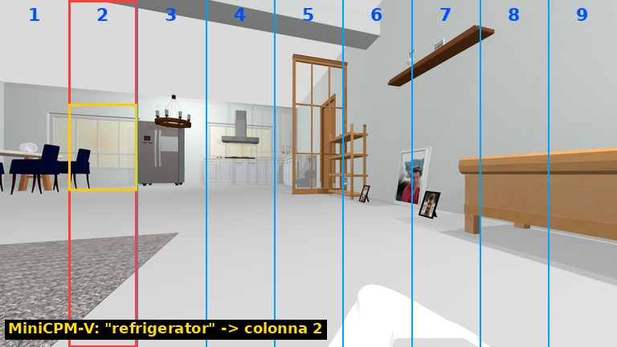
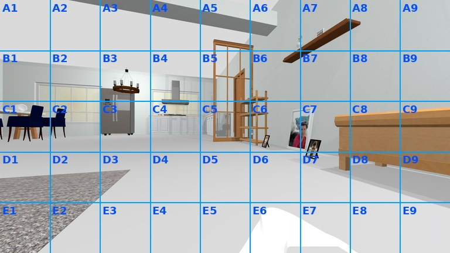
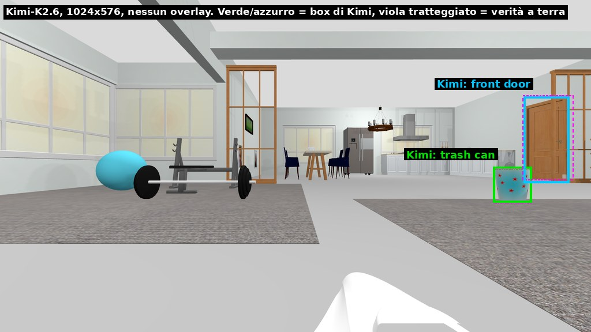
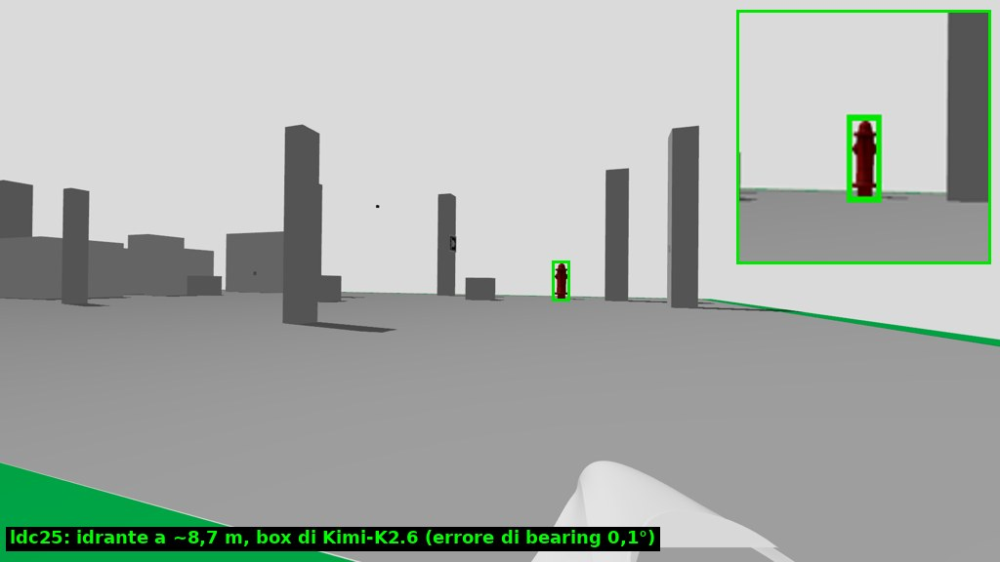
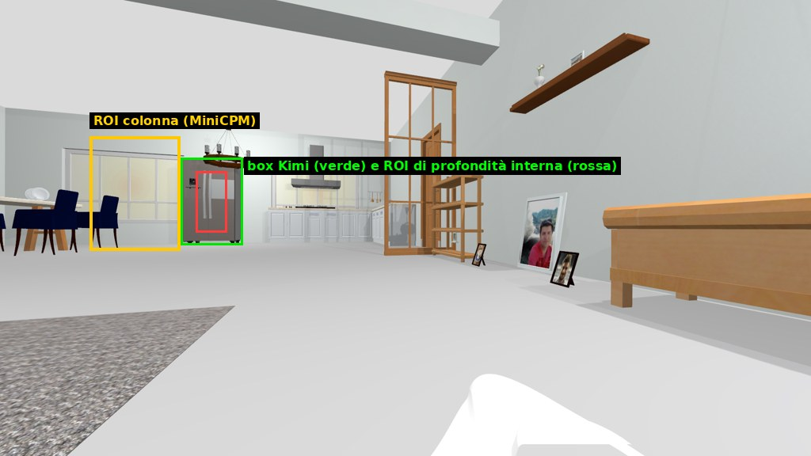
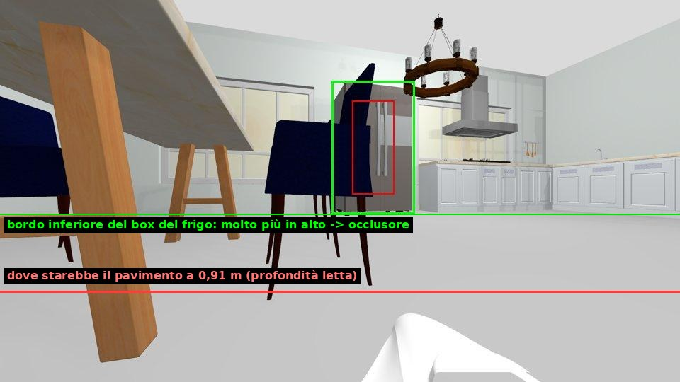
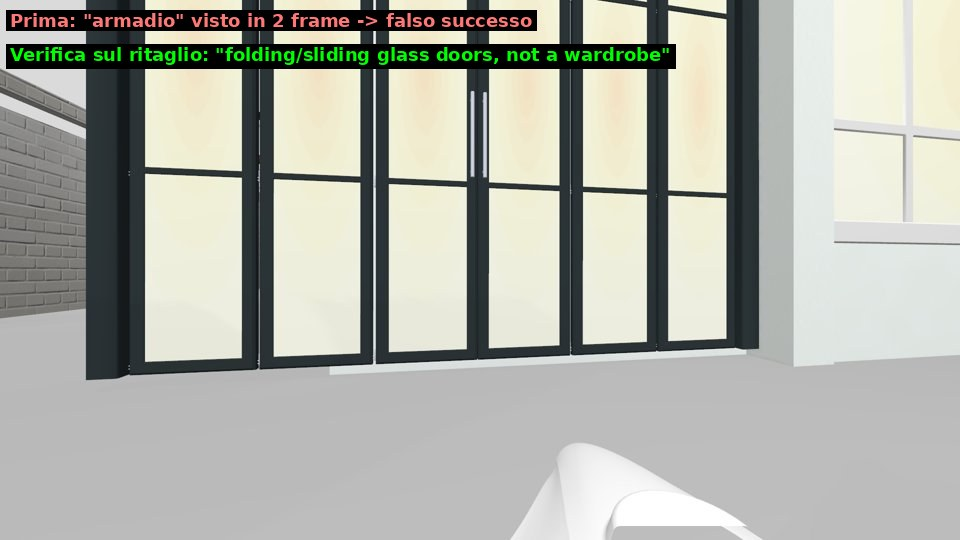

# Changelog

Modifiche all'agente Nebius e alla simulazione, dalla più recente.

## 21 ottobre 2026 (sera), branch `mapless`: navigazione semantica senza stima di posa

Obiettivo: navigare senza alcuna stima di posa (niente EKF, SLAM, odometria, giroscopio, Nav2) e con soli modelli su Nebius (niente YOLO locale). Il robot insegue ciò che vede: il modello vision rilocalizza il bersaglio a ogni passo, una guida reattiva sul lidar istantaneo evita gli ostacoli. Tra due osservazioni il moto è un comando breve in anello aperto, che la percezione successiva corregge; nessuno stato si accumula.

### In breve

- **Sim e robot senza posa**: `go2_sim.launch.py localization:=none` (default sul branch: niente sostituta dell'EKF, niente TF `map`); `go2_real.launch.py localization:=none`: profondità con 0,3 s di punti e scan ostacoli con 0,3 s di nuvole, nel frame del corpo. Il launcher dell'agente non usa IMU, posa, Nav2 né posti (`NEBIUS_NAV2=off`).
- **`ros2_drive_toward`** (nuovo tool MCP, `drive.ts`): fette di al massimo 3 s verso una direzione del corpo; sceglie la direzione libera più vicina nello scan istantaneo (un istogramma polare a una riga), rallenta e si ferma a 0,7 m dal centro della base (il muso è a ~0,35 m e lo scan scarta i punti entro 0,45 m come corpo del robot). Tutti gli avanzamenti dell'agente passano di qui: verso il bersaglio con il suo bearing, fino a 1,5 m per osservazione.
- **Esplorazione dalla vista corrente** (`currentViewExplore`): senza giroscopio le direzioni ricordate da un giro di ricerca non valgono dopo rotazioni a tempo. Dopo un giro senza bersaglio il robot imbocca una porta che il modello vision vede ora, oppure avanza se c'è spazio, oppure ruota e guarda di nuovo.
- **Nemotron-3.5-Super-VL** (NVIDIA) come modello vision: profilo con `enable_thinking: false` (1 s invece di 2 s, stesso box); restituisce i box su griglia 0–1000, `normalizeBox` lo riconosce.
- **Sicurezza**: `ros2_estop` ora interrompe anche un `ros2_move_for` o un `ros2_drive_toward` in corso (prima il primo continuava fino alla sua scadenza, fino a 3 s). Le decisioni di Nemotron hanno 10 s senza retry (`NEBIUS_DECISION_TIMEOUT_S`): quando l'endpoint si blocca decide subito la policy deterministica, prima servivano fino a 2 × 60 s.
- Scan ostacoli pubblicato reliable (AgenticROS si abbona in reliable; le costmap best effort continuano a riceverlo). Dopo ogni movimento l'agente aspetta 0,5 s prima di osservare (`NEBIUS_SETTLE_S`): la profondità non compensata altrimenti contiene punti presi durante la rotazione.

### Prove in simulazione (casa, `localization:=none`)

| Prova | Esito |
| --- | --- |
| `ros2_drive_toward` dritto per 6 fette dallo spawn verso la sala da pranzo | passa fra tavolo e sedie (deviazioni di −15° e +5°), arriva in spazio aperto, ostacolo più vicino 1,6 m |
| e-stop a 1 s da una fetta | `aborted` a 1,0 s, poi 5 cm di scivolamento (rampa di CHAMP) |
| "vai vicino al frigorifero", Kimi-K2.6 + Lightning | arrivato in 7 passi a 1,21 m |
| idem con Nemotron-3.5-Super-VL | arrivato in 12 passi a 1,27 m (una deviazione a tempo della policy al passo 6) |
| confronto vision su 7 frame con verità a terra | Kimi: 7/7 visibilità, errore di direzione mediano 2,0°, 1,20 s; Nemotron VL: 7/7, 1,1°, 1,22 s |
| "vai vicino al letto" (altra stanza) | non raggiunto in 24 passi: il robot gira nel soggiorno; nel secondo tentativo Lightning è andato in timeout dal passo 11 |

### Resta aperto

- Esplorazione di più stanze senza memoria: le porte viste a 40° durante una camminata vengono ignorate (limite ±30°), un giro costa 5 viste (90° con HFOV 94,7°) e non c'è memoria dei luoghi già visti. Prossimo passo proposto: memoria dei luoghi per aspetto (descrizione del modello vision) e porte scelte dal modello sulla vista corrente.
- La deviazione a tempo della policy (`detour`) è ridondante con la guida reattiva e allunga l'avvicinamento.
- Sul robot: pitch del corpo non compensato (pavimento stimato per corpo in bolla), copertura dello scan con 0,3 s di nuvole Livox da verificare in RViz.
- Lo script `test` dei package usa `--test-force-exit`, che tronca l'esecuzione in modo non deterministico (35–44 test su 44 eseguiti); senza il flag passano tutti.

## 21 ottobre 2026: navigazione con Nav2 sul Go2 reale e simulazione uguale al robot

Durante le prove sul Go2 l'agente non usava mai Nav2: si muoveva solo con `cmd_vel`. Le cause, i fix e il nuovo modo di navigare, tutti provati nella simulazione con il Nav2 DUA come sul robot.

### Perché Nav2 non partiva

- L'agente manda goal a Nav2 in due soli casi: posti noti (file di stanze, assente sul reale) ed esplorazione a frontiere dopo un giro di ricerca senza bersaglio. L'avvicinamento a un bersaglio visto era sempre in `cmd_vel`.
- La costmap globale del Nav2 DUA aveva `track_unknown_space: false`: nessuna cella sconosciuta, quindi `agenticros_explore` non trovava frontiere (`no_frontiers`, 0 goal), e dopo due tentativi l'agente passava al `cmd_vel`. I log di `bt_navigator` sul PC non mostravano alcun goal ricevuto. Fix in `dua_nav2` (`config/dottorcane.yaml`, costmap globale).
- `ros2_estop` non annullava i goal di Nav2 sul reale (`skillPaths: []`): ora c'è la skill `go2-nav2-dua`.

### In breve

- **Simulazione uguale al robot** (`go2_sim.launch.py profile:=real`, il default): topic, frame, sensori e middleware del DottorCane. Camera frontale `/dottorcane/go2_control/frontvideo/*` (1280×720, HFOV 94,7°), Mid-360 `/dottorcane/sensors/livox_lidar_driver/point_cloud(/deskewed)` nella posa reale (pitch 30°), IMU `/dottorcane/go2_control/imu`, niente camera di profondità; `/dottorcane/slam/ekf_global/odometry` e TF `map → dottorcane/base_link` con `map` alla posa di partenza (la posa di Gazebo fa da EKF + LIO-SAM, l'agente non la legge mai); `go2_real.launch.py` per profondità e scan dal lidar; rmw_zenoh. Nav2 è quello DUA nel suo container, `explore` viene da `go2_real_nav.launch.py nav2:=dua`: gli stessi passi del robot. `profile:=zed` è la simulazione precedente.
- **Pavimento come ostacolo** (`lidar_camera_depth.py`): era la causa del "percorso bloccato" anche sul robot. Il nodo accumulava 0,5 s di punti nel frame del lidar e il corridoio riconosceva il pavimento da quota e assetto supposti della camera. Dopo ogni movimento il pavimento risultava un ostacolo per circa mezzo secondo: corridoio a 0,37 m invece di 4 m. Sul robot bastano pochi centimetri di errore su `NEBIUS_CAMERA_HEIGHT_M`, o un paio di gradi di pitch della camera, per ottenere lo stesso effetto. Ora il pavimento si toglie prima della proiezione, in base all'altezza da terra nel frame `map` (allineato alla gravità dall'EKF, `base_height`, `floor_height` 6 cm), e i punti sono compensati per il moto.
- **Scan ostacoli a 10 Hz** (`lidar_obstacle_scan.py`): il lookup TF bloccante in un executor single-thread dava uno scan ogni ~6 s.
- **Avvicinamento con Nav2** (`nav2ApproachGoal`, `agent.ts`): un bersaglio confermato a più di 1,5 m oltre la distanza di arrivo si raggiunge con un goal Nav2 sulla congiungente, 0,5 m prima della distanza di arrivo; l'ultimo metro resta visivo. Nav2 aggira i mobili.
- **Esplorazione con Nav2**: le frontiere ora funzionano (`min_goal_distance_m` 1 m in `agenticros_explore`, contro le celle sconosciute attaccate al corpo); senza frontiere, la camminata verso la direzione scelta è un goal Nav2 invece di un avanzamento a tempo.
- **Memoria della sessione**: posizione del bersaglio nel frame `map` (un avvistamento vicino nello stesso punto conta come "avvicinato", non come primo avvistamento: la guardia `closeFirstSighting` faceva girare il robot a 1 m dal frigorifero); "ricorda questo posto come cucina"; ogni bersaglio raggiunto diventa un posto ("torna dal frigorifero"). File `logs/places_session.json`.
- **Tool MCP** `ros2_robot_pose` (posa da `AGENTICROS_POSE_TOPIC`) e `ros2_navigate_to_pose`.

### Prove in simulazione (casa, dallo spawn)

| Richiesta | Prima | Dopo |
| --- | --- | --- |
| "vai vicino al frigorifero" (visibile a 8 m dietro divano e tavolini) | 11 passi, "percorso bloccato" | 3–5 passi: un goal Nav2 da 7 m (15 s), arrivo a 1,0–1,3 m |
| "vai vicino al letto" (in un'altra stanza) | distanza libera 0,34–0,45 m a ogni passo, 16 passi senza arrivo | una frontiera con Nav2 (5,4 m), arrivo a 1,08 m in 16 passi |
| "ricorda questo posto come cucina", poi "vai in cucina" | – | un goal Nav2 (14,5 s), arrivo a 3,5 cm dalla posa salvata |
| "torna dal frigorifero" (posto salvato in automatico) | – | un goal Nav2 (15 s), frigorifero al centro dell'immagine |

Con `nvidia/Nemotron-3_5-Lightning` (il default) l'ultima prova del frigorifero è arrivata in 5 passi. Il 21 ottobre per alcune ore Lightning è andato in timeout anche su richieste di 8 token: le altre prove usano `NEBIUS_POLICY=auto` (Nemotron solo per interpretare la richiesta) con `NEBIUS_REASONING_MODEL=nvidia/NVIDIA-Nemotron-3-Nano-30B-A3B`, che una volta ha letto "vai vicino al frigorifero" come richiesta di descrizione.

### Resta aperto

- Sul robot: verificare in RViz che la costmap globale si riempia (il filtro di altezza 0,1–1,0 m è nel frame `map`: conta dove sta lo z=0 di LIO-SAM), misurare `NEBIUS_CAMERA_HEIGHT_M` e controllare con `/dottorcane/agent/depth` che il pavimento non compaia.
- Le velocità di Nav2 (MPPI fino a 1 m/s e 1,5 rad/s) non passano dai limiti di AgenticROS.
- Il lidar simulato non riproduce lo schema non ripetitivo del Mid-360: la costmap della sim è più densa di quella reale.

## 13 ottobre 2026 (pomeriggio): direzione dall'IMU, ostacoli bassi, sblocco delle rotazioni

La prima serie A/B senza mappa aveva mostrato che il problema era il corpo del robot, non la scelta della direzione. Queste modifiche lo affrontano; misure e dettagli in [ESPLORAZIONE_GRAFO.md](ESPLORAZIONE_GRAFO.md).

### In breve

- **Direzione dall'IMU**: la direzione stimata usa la rotazione misurata dal giroscopio della camera (nuovo tool `ros2_imu_yaw`, `NEBIUS_IMU_TOPIC`), non più quella comandata. Vicino ai mobili le rotazioni ne fanno anche il 40%, o niente.
- **Oggetti bassi**: il nuovo tool `ros2_depth_corridor` vede, in un corridoio 3D largo quanto il corpo, gli ostacoli più bassi della camera (cestino, tavolino, porta-manubri). Offline gli ostacoli mancati scendono da 5 a 1 su 31 frame.
- **Sblocco delle rotazioni**: se una rotazione gira meno di metà del comando, il robot fa un passo avanti, una svolta nel verso opposto, poi indietro, e alla fine si ferma dicendo che è bloccato.
- **Verifica sul ritaglio**: il modello nomina l'oggetto prima di dire se è il bersaglio. I tavoli accettati come scrivania scendono da 34 a 6 su 49.
- **Transport locale**: rispetta `queueLength`. L'IMU a 100 Hz perdeva messaggi con la coda di default da 10, e la direzione arrivava a sbagliare di 27°.
- **Risultato**: nella seconda serie A/B il letto è stato raggiunto 5 volte su 6, contro 2 su 6 della prima. Missioni con esplorazione: `vision` 2 su 5, `open` 3 su 5. Il default resta `open`.

### Seconda serie A/B

| Missione | `vision` | `open` |
|---|---|---|
| letto, dallo spawn | 2 su 3 (21 e 29 passi) | 3 su 3 (36–37 passi) |
| scrivania, dallo spawn | 0 su 2 | 0 su 2 (due falsi arrivi su una struttura del soggiorno, "reception desk") |

Le rotazioni comandate a meno di 0,4 m da un ostacolo sono scese da 85 su 330 a 15 su 222. A fine corsa la direzione è entro ±10° in 8 corse su 10, mentre nella prima serie l'errore superava i 140° in 3 corse su 9.

### Insidia della simulazione

Dopo che il robot è rimasto incastrato contro il porta-manubri della palestra, la sim è rimasta degradata fino al riavvio: −90° comandati diventavano −57…−68° e una camminata dritta curvava di 90°. Prima di una serie conviene rilanciare la sim e controllare le rotazioni con `scripts/vision_eval/imu_check.sh`.

### Resta aperto

- La scrivania: dallo spawn la regola dello spazio libero porta il robot davanti alla struttura del soggiorno, che la verifica accetta come "reception desk".
- L'IMU a volte misura il 3–5% in meno su ogni rotazione: in una corsa la direzione ha sbagliato di 44° alla fine. La causa non è chiara.

## 13 ottobre 2026: grafo dei luoghi, deviazione intorno agli ostacoli e serie A/B senza mappa

Sempre la modalità senza mappa (`nav:=none`). Studio completo, misure e immagini: [ESPLORAZIONE_GRAFO.md](ESPLORAZIONE_GRAFO.md); numeri grezzi: [RISULTATI.md](../scripts/vision_eval/RISULTATI.md).

### In breve

- **Grafo dei luoghi con la scelta di Kimi** (`NEBIUS_EXPLORE_CHOICE=vision`): ogni giro è un nodo con le direzioni già percorse, e Kimi sceglie dove camminare guardando tutte le viste del giro. Offline sceglie meglio della direzione più aperta (58–65% contro 38% delle camminate verso la stanza del bersaglio). A ciclo chiuso, però, su 16 corse entrambe le modalità hanno raggiunto letto e scrivania 1 volta su 5, quindi **il default resta `open`**.
- **Il limite vero è il corpo**: il robot si incastra contro oggetti bassi che la profondità frontale non vede (cestino, tavolino, porta-manubri). Lì le rotazioni riescono in mediana al 40%, e la direzione stimata deriva fino a 180°.
- **Calibrazione dei movimenti corretta**: `NEBIUS_TURN_EFFICIENCY=0.77` e `NEBIUS_FORWARD_EFFICIENCY=0.84` in `run_nebius_agent.sh`. Con 0,65/0,7 il robot girava e camminava il 20% in più del comandato.
- **Meno falsi arrivi e meno bersagli persi**: un primo avvistamento già vicino e che riempie l'immagine non si conferma per ripetizione, nemmeno a distanza ignota; `face_target` entro 12° dal centro è rifiutato a favore di `approach_target`.
- **Deviazione intorno agli ostacoli**: con il bersaglio confermato, se il robot è bloccato o non ha spazio per avanzare, gira di 40° e cammina fino a 0,7 m, poi riprova dall'altro lato. Si arrende dopo 3 deviazioni.
- **Un timeout della camera non chiude più il compito**: conta come un'osservazione mancata.
- **Nuovi strumenti di valutazione** in `scripts/vision_eval/`: serie A/B a ciclo chiuso, posa vera e traiettorie registrate fuori dall'agente, deriva del grafo, rotazioni rispetto agli ostacoli.

### Grafo dei luoghi (`policy.ts`, `perception.ts`, `agent.ts`)

Le stanze come nodi e le porte come archi non funzionano in questa casa. Centro ed est sono un unico open space, le porte a soffietto di vetro sembrano porte ma non si attraversano, e Kimi riporta solo un passaggio vero su tre. I nodi quindi sono i **luoghi** in cui il robot fa un giro, con la posizione stimata dai movimenti, e gli archi sono le direzioni già percorse. Alla fine di ogni giro senza bersaglio, Kimi riceve un mosaico delle viste, con quelle già esplorate segnate, e restituisce la vista e il punto verso cui camminare (log `[Graph]` e `[Explore] vision model: …`). Etichette di stanza e "cosa c'è oltre" sono state misurate e scartate.

### Serie A/B a ciclo chiuso

| Missione | `vision` | `open` |
|---|---|---|
| letto, dallo spawn | 1 su 3 (più un falso arrivo sul divano) | 1 su 3 |
| scrivania, dallo spawn | 0 su 2 (più un falso arrivo sul tavolino) | 0 su 2 |
| frigorifero, dalla camera (nessuna esplorazione) | 2 su 3 | 3 su 3 |

La serie ha fatto emergere due difetti, corretti subito dopo: la guardia del primo avvistamento non copriva la distanza ignota (falso arrivo sul divano), e una deviazione senza spazio per svoltare finiva con "Nessuna azione sicura disponibile." invece di provare l'altro lato. Resta aperto il tavolino preso per una scrivania, anche dalla verifica sul ritaglio.

### Prossimi passi proposti

La direzione dall'IMU della camera, contro la deriva e per accorgersi delle rotazioni bloccate; gli ostacoli bassi, con la profondità sotto l'orizzonte confrontata con il pavimento. Poi va ripetuta la serie A/B.

## 12 ottobre 2026: esplorazione senza mappa e rilevamento di Nav2

Modifiche all'adapter Nebius (`tools/agenticros/packages/agenticros-nebius/src/`) per quando il robot non ha una mappa (`nav:=none`) e per quando ce l'ha (`nav:=map`). La versione definitiva costruirà prima una mappa e poi la userà; questa resta la modalità di riserva.

### In breve

- **Nav2 a volte non veniva visto** anche se era acceso: "vai in cucina" finiva con `Nav2 not running; 0 known places` e il robot cercava a vista. Ora il controllo viene ripetuto prima di rinunciare alla mappa.
- **Giro di ricerca più veloce**: rotazioni da 90° invece di 45°, 5 per un giro completo invece di 9.
- **7 esplorazioni invece di 4**, per usare gli stessi passi e lo stesso tempo di prima con giri che costano la metà.
- **Scarto degli avvistamenti "fantasma"**: un oggetto scambiato per il bersaglio, che sparisce ogni volta che il robot si gira a guardarlo, non lo fa più girare avanti e indietro.

### Nav2 non rilevato (`robot.ts`)

All'avvio l'agente cerca l'azione `/navigate_to_pose` fra quelle del grafo ROS. L'agente è un processo nuovo a ogni lancio e la discovery DDS a volte si ferma a metà: con Nav2 acceso, in 1 avvio su 8 sono arrivati 19 topic su 98, senza quelli di Nav2. Se Nav2 non compare, ora il controllo viene ripetuto fino a 2 volte a 1 s di distanza, con il log `[Navigation] Nav2 not seen on the ROS graph, retrying discovery (1/2)`. Su 8 avvii con Nav2 acceso: 8 su 8 con le 9 stanze note, e in uno il secondo tentativo ha recuperato una discovery parziale. Quando Nav2 è spento davvero, l'avvio impiega circa 2 s in più.

### Giro di ricerca da 90° (`policy.ts`)

La camera vede ~110°. Sui frame della casa ([`scripts/vision_eval/`](../scripts/vision_eval/README.md)) Kimi-K2.6 trova i bersagli anche al bordo dell'immagine:

| Distanza dal centro dell'immagine | Bersagli trovati |
|---|---|
| 0–15° | 79% |
| 15–30° | 96% |
| 30–45° | 83% |
| 45–55° | 87% |

Con rotazioni da 90° ogni direzione cade entro ±45° in almeno una vista, quindi non serve guardarla 2–3 volte come con i passi da 45°. Il budget di esplorazioni sale da 4 a 7: con 4 il robot si arrendeva dopo ~42 degli 80 passi disponibili.

### Avvistamenti fantasma (`policy.ts`, `agent.ts`)

In una prova un divano veniva "visto" come letto solo quando stava al bordo dell'immagine. Il robot si girava a guardarlo, il "letto" spariva, la ricerca lo riportava al bordo, e così per ~20 passi. Ora un avvistamento non confermato che sparisce due volte quando il robot si gira a guardarlo, alla stessa direzione (±20°), viene ignorato finché il robot resta in quel punto. Il log è `[Perception] ignoring the sighting at … deg`. Le rilevazioni YOLO forti (≥ 0,8) non vengono mai scartate, e dopo ogni spostamento di esplorazione si riparte da zero.

### Prove a ciclo chiuso

Casa, `nav:=none`, partenza dallo spawn, arrivo verificato sulla posa reale di Gazebo:

| Prova | Esito |
|---|---|
| "vai in camera da letto", passi da 45° (prima) | 0 su 2: 80 passi esauriti senza trovare il letto |
| "vai in camera da letto", 90° e 4 esplorazioni | non arrivato: esplorato verso est, resa dopo 42 passi |
| "vai in camera da letto", 90° e 7 esplorazioni | **arrivato** in 17 passi, 1,01 m dal letto |
| "vai in camera da letto", 90° e 7 esplorazioni | **arrivato** in 18 passi, 0,99 m, ~150 s |
| "vai vicino al frigorifero" (controllo) | arrivato in 13 passi, 0,92 m (prima 11) |

Le corse sono poche e la direzione della prima esplorazione conta molto: il miglioramento è reale, ma senza mappa la stanza giusta resta non garantita. Con `nav:=map` "vai in camera da letto" arriva con Nav2 al primo colpo.

### Provati e scartati

- **Memoria del bersaglio confermato**: dopo un frame mancato, il robot tornava a guardare dove l'aveva visto. Nella prova è scattata due volte senza ritrovare il bersaglio e ha solo aggiunto passi. Tolta.
- **Puntare la porta quando il bersaglio è dietro una porta**: sulle risposte salvate di Kimi, il riquadro del bersaglio cade dentro il riquadro di una porta solo nel 17% dei casi con il percorso davvero bloccato, e nell'8% di quelli con il percorso libero. Il segnale è troppo debole: non implementato.

### File

`robot.ts` (retry di Nav2), `policy.ts` (passo di ricerca, budget di esplorazioni, fantasmi), `agent.ts` (scarto dei fantasmi prima della verifica sul ritaglio, testo del tool `search`), `__tests__/policy.test.ts` (27 test). Docs: [NEBIUS_AGENTICROS.md](NEBIUS_AGENTICROS.md), `src/README.md`.

## 12 ottobre 2026: percezione con il modello vision (versione con e senza YOLO)

Modifiche all'adapter Nebius (`tools/agenticros/packages/agenticros-nebius/src/`) e alla documentazione. Confronto sintetico prima/dopo con i numeri: [CONFRONTO_PERCEZIONE.md](CONFRONTO_PERCEZIONE.md). Il piano completo, con il metodo di valutazione e tutte le tabelle, è in [PIANO_PERCEZIONE_VLM.md](PIANO_PERCEZIONE_VLM.md).

### In breve

- Nuova modalità **senza YOLO**, ora il **default**: `NEBIUS_PERCEPTION=vlm`. Il modello vision localizza ogni bersaglio; YOLO non viene caricato né scaricato. `NEBIUS_PERCEPTION=yolo` attiva la versione con YOLO.
- Il modello vision di default diventa **`moonshotai/Kimi-K2.6`**, che restituisce direttamente il **bounding box** del bersaglio. Le 9 colonne restano solo per i modelli che non sanno dare coordinate, come MiniCPM-V.
- Corretto un **bug del parser JSON** che scartava molte risposte del modello vision.
- Nuove **guardie contro gli arrivi falsi**, utili in entrambe le modalità.
- Per la versione con YOLO, **YOLO26s** è un aggiornamento consigliato che non richiede modifiche al codice.

```bash
./scripts/run_nebius_agent.sh "vai vicino al frigorifero"                         # senza YOLO (default)
NEBIUS_PERCEPTION=yolo ./scripts/run_nebius_agent.sh "vai vicino al frigorifero"  # con YOLO
```

> **Da fare a mano**: se nel tuo `.env` c'è ancora `NEBIUS_VISION_MODEL=openbmb/MiniCPM-V-4_5`, cambialo in `moonshotai/Kimi-K2.6` (oppure toglilo: è il nuovo default). Le variabili di `.env` vincono sul default.

### Come è stato deciso

Le scelte vengono da prove sulla simulazione, non da ipotesi:

- 56 frame della casa (7 stanze × 8 direzioni) e 17 di ldc25, con profondità e posa reale;
- verità a terra calcolata proiettando le mesh dei mobili nella camera, con le occlusioni escluse;
- 184 domande uguali per ogni configurazione: 128 con il bersaglio visibile, 56 con il bersaglio assente;
- 10 corse a ciclo chiuso del prototipo, con l'arrivo verificato sulla posa reale di Gazebo.

Script, risultati e istruzioni per ripetere le prove: [`scripts/vision_eval/`](../scripts/vision_eval/README.md).

### 1. Colonne, griglia o box?

Prima il frame veniva ridotto a 768×432 e diviso in 9 colonne numerate. MiniCPM-V indicava la colonna del centro del bersaglio e una taglia (`small`, `large`...); la distanza si misurava su tutta la banda della colonna.



*Il frigorifero è nella colonna 3, MiniCPM-V risponde 2. La banda gialla è la regione in cui veniva misurata la distanza.*

È stata provata anche una griglia 9×5, con celle etichettate da A1 a E9:



Risultati sulle stesse 184 domande:

| Variante | Bersagli trovati | Falsi positivi | Errore di direzione (mediana) |
|---|---|---|---|
| MiniCPM, 9 colonne (prima) | 52% | **4%** | 3,9° |
| MiniCPM, griglia 9×5 | 71% | 21–27% | 3,9–5,2° |
| MiniCPM, bbox (768 o 1344 px) | 80–82% | 12–14% | 5° |
| Kimi-K2.6, bbox, 1024 px — **in uso** | **86%** | **4%** | **0,2°** |

In grassetto il valore migliore di ogni colonna.

- **Con MiniCPM le colonne sono la scelta migliore**, perché il modello non sa dare coordinate: i suoi box hanno IoU mediano 0,13. La griglia è peggio e più complicata, e aumentare la risoluzione non aiuta.
- **Per la versione senza YOLO serve un modello che dia direttamente il box.** Sulla chiave Nebius l'unico preciso e con latenza stabile è `moonshotai/Kimi-K2.6`:
  - DeepSeek-V4.1-Flash è preciso ma ha un 90° percentile di 23–29 s;
  - Kimi-K3, Qwen3.8 e GLM-5.3-Flash impiegano 20–40 s;
  - Gemma-3 sbaglia di circa 10°;
  - i Nemotron e Qwen3.5 non accettano immagini.

  Kimi va usato senza overlay, con coordinate in frazioni 0–1 e risposta in JSON strutturato.



*In verde e azzurro i box di Kimi, in viola tratteggiato la verità a terra.*

- **Due insidie di Kimi:**
  - il thinking è attivo per default: va spento con `chat_template_kwargs: {thinking: false}` (lo fa il profilo in `vision.ts`; `reasoning_effort: "none"` su K2.6 non funziona);
  - con coordinate 0–1000 a volte restituisce la y in pixel (IoU 0,74): per questo si chiedono frazioni (IoU 0,91).
- **Risoluzione:** 1024×576 è il punto ottimo. A 768 px si perdono più bersagli; a 1920 px salgono i falsi positivi (11%) e i token raddoppiano.
- **Latenza e costo:** circa 1 s a chiamata, come MiniCPM prima. Circa $0,0015 a passo (Kimi costa circa 4 volte MiniCPM a chiamata).
- **Idrante di ldc25 da 1,4 a 9 m:** Kimi lo trova 14 volte su 14, con errore massimo di 0,4° e distanza esatta entro 3 cm.



Con un box preciso anche la distanza diventa affidabile: la profondità si misura al centro del box (riquadro rosso) e non su tutta la banda della colonna (giallo), che include altri oggetti.



Confronto sui 68 bersagli COCO della casa (stesse domande):

| Pipeline | Trovati e localizzati |
|---|---|
| Prima: YOLOv8n, poi MiniCPM a colonne, parser vecchio | 57% (solo il 26% con un box preciso) |
| Prima, con il parser corretto | 69% |
| YOLO26s + MiniCPM | 74% |
| YOLO26s + Kimi-K2.6 | **88%** |
| Solo Kimi-K2.6 (senza YOLO) | 87%, sempre con box preciso |

### 2. Bug corretto: il parser JSON

`parseJsonObject` prendeva il testo dalla prima `{` all'ultima `}`. MiniCPM-V chiude spesso il JSON compatto con una graffa in più (`...}}}`), e così l'intera risposta veniva scartata: il bersaglio risultava "non visibile" anche quando il modello l'aveva visto.

- Nella casa si perdeva il 9% delle risposte.
- Per l'idrante di ldc25 si perdevano 10 avvistamenti su 12.
- Il parser nuovo (`vision.ts`) cerca il primo oggetto JSON completo contando le graffe e rispettando le stringhe.
- La correzione vale anche per la versione con YOLO: da sola porta i bersagli trovati dal 57% al 69%.
- Con Kimi in più c'è l'output strutturato (`response_format` json_schema): 0 risposte non valide su 184.

### 3. Cosa hanno rivelato le prove a ciclo chiuso

Le prime corse sono finite con falsi successi. Ognuna delle guardie seguenti corregge un errore visto davvero; valgono anche con YOLO.

**Fermo davanti a una sedia invece che al frigo.** Il box del frigo conteneva lo schienale di una sedia più vicina e la profondità misurava la sedia (0,91 m invece di circa 3,4 m). Ora `depthConsistentWithBox` (`policy.ts`) confronta la distanza letta con la posizione del box. Per un oggetto appoggiato a terra a quella distanza, il bordo inferiore del box dovrebbe stare sulla riga del pavimento, calcolata dall'altezza della camera (0,385 m). Se sta molto più in alto, la lettura appartiene a qualcosa davanti: distanza ignota, niente arrivo. Entro 1,5 m intercetta 17 letture sbagliate su 20, senza falsi allarmi su 88 letture corrette. Gli oggetti sopra l'orizzonte (una TV a parete) non vengono giudicati.



**Porta a soffietto scambiata per armadio.** Il modello vision l'ha vista come "armadio" in due frame di fila, e la conferma su due frame non basta contro un errore coerente. Ora ogni avvistamento del modello vision viene ricontrollato su un ritaglio ingrandito, nel momento in cui verrebbe confermato e prima di dichiarare l'arrivo (1–2 chiamate in più per compito). Nella prova ha respinto 5 falsi avvistamenti (porte ×2, condizionatore ×2, varco antitaccheggio); poi il robot ha trovato l'armadio vero e si è fermato a 0,81 m.



**Due aggiustamenti della policy:**

- quando il bersaglio è appena avvistato di lato, il controller rifiuta `search` e chiede `face_target`. Nemotron usava `search(right)` per "girarsi verso" il bersaglio e lo superava, perdendo due passi;
- se il bersaglio è visibile ma la distanza è ignota, il passo è al massimo 0,5 m. Il corridoio di profondità davanti al robot non vede ostacoli più bassi della camera: in una prova il robot ha fatto 1 m alla cieca sul cestino.

Inoltre, con il bersaglio lontano il passo minimo di avvicinamento è 1 m: Nemotron copiava dallo storico passi da 0,5 m e procedeva a passettini.

Il robot continua a non aggirare gli ostacoli: in quel caso ora risponde onestamente "Il percorso verso il bersaglio è bloccato", invece di dichiarare un arrivo falso.

Esiti finali del prototipo:

| Prova | Esito |
|---|---|
| casa, senza YOLO, "vai vicino al frigorifero" | arrivato in 11 passi, ~70 s, 0,89 m (vero 0,87) |
| casa, senza YOLO, "vai vicino al cestino della spazzatura" | arrivato in 5 passi, 0,73 m |
| casa, senza YOLO, "vai vicino all'armadio" | 5 falsi respinti, armadio vero a 0,81 m |
| ldc25, senza YOLO, "cerca l'idrante rosso e vacci vicino" | arrivato in 10 passi, 0,93 m |
| ldc25, con YOLO e Kimi, stessa richiesta | arrivato; colore verificato da Kimi |

### 4. YOLO (versione con YOLO)

Il progetto usa **YOLOv8n** (gennaio 2023), in ONNX su CPU, con la detection a riquadri (frame intero più 5 riquadri sull'orizzonte). Con la stessa pipeline, sui frame della casa:

| Modello | Bersagli COCO trovati nella casa | Tempo per frame |
|---|---|---|
| YOLOv8n (attuale) | 36% | **0,47 s** |
| YOLO11s | 44% | 1,06 s |
| YOLO26s (gennaio 2026, consigliato) | **57%** | 0,99 s |

YOLO26s funziona senza toccare il codice, a una condizione: va esportato con `end2end=False`. L'export di default dà un output `[1, 300, 6]` che il decoder rifiuta; con `end2end=False` l'output è `[1, 84, 8400]`, come YOLOv8. Ultralytics è già installato nel container:

```bash
mkdir -p /tmp/yolo26 && cd /tmp/yolo26
python3 -c "from ultralytics import YOLO; YOLO('yolo26s.pt').export(format='onnx', imgsz=640, end2end=False)"
cp yolo26s.onnx ~/.agenticros/models/yolo26s.onnx
AGENTICROS_YOLOV8_MODEL=~/.agenticros/models/yolo26s.onnx ./scripts/run_nebius_agent.sh "vai vicino al frigorifero"
```

YOLOE-26, che accetta nomi di oggetti arbitrari, qui non conviene (38–43%). Se la licenza AGPL di Ultralytics è un problema, l'alternativa è RF-DETR (Apache-2.0), che però non è stato provato e richiederebbe un decoder nuovo.

### 5. Modifiche nel codice

File in `tools/agenticros/packages/agenticros-nebius/src/`:

| File | Cosa cambia |
|---|---|
| `vision.ts` (nuovo) | profili per modello vision (`box` o `columns`, larghezza dell'immagine, parametri come lo spegnimento del thinking di Kimi, supporto all'output strutturato); parser JSON robusto; `normalizeBox` (frazioni o 0–1000, angoli ordinati, box degeneri scartati); schema della risposta |
| `perception.ts` | `describe` usa il box o le colonne secondo il profilo; tutte le chiamate al modello vision passano da `ask()` (timeout 20 s, 1 retry, profilo); attributi del bersaglio nel prompt; `verifyCandidate` con modalità forzata per gli avvistamenti del modello vision |
| `policy.ts` | `localization: "box" \| "column"` al posto di `source` per le regole geometriche (un box del modello vision vale come uno di YOLO); `occluded`; `depthConsistentWithBox`; passo massimo a distanza ignota; regola `face_target`; passo minimo 1 m da lontano |
| `agent.ts` | modalità `yolo`/`vlm`; verifica sul ritaglio degli avvistamenti del modello vision; guardia di occlusione dopo la lettura della profondità; in modalità `vlm` nessun movimento se il modello vision non risponde, compito interrotto dopo 3 fallimenti |
| `index.ts` | `NEBIUS_PERCEPTION` (default `vlm`), `NEBIUS_VISION_GROUNDING`, `NEBIUS_CAMERA_HEIGHT_M`; default `NEBIUS_VISION_MODEL=moonshotai/Kimi-K2.6`; riga di avvio `[Perception] mode=… vision=… grounding=… width=…` |
| `__tests__/` | `vision.test.ts` nuovo; `policy.test.ts` con i casi nuovi (24 test) |

Nel repo: `.env.example`, `scripts/run_nebius_agent.sh` (solo un commento), `src/README.md`, `docs/NEBIUS_AGENTICROS.md`, `CLAUDE.md` e `tools/agenticros/CLAUDE.md`.

Cosa **non** cambia: Nemotron e i suoi tool, i tool MCP e i limiti di sicurezza, esplorazione e Nav2, la misura di profondità (12° percentile), i log.

Provati e scartati: il controllo "distanza letta contro metri percorsi" (un riferimento sbagliato faceva scartare le letture giuste) e il flag `occluded` chiesto al modello vision come criterio di decisione (lo indovina solo nel 45% dei casi).

### 6. Limiti noti

- Senza Nav2 il robot non aggira tavoli e sedie davanti al bersaglio. Con `nav:=map` la stanza nota si raggiunge prima con Nav2.
- Il sensore di profondità simulato vede attraverso il vetro ma non attraverso i telai: le "porte" su vetrate non si possono scartare con la profondità.
- Gli errori semantici coerenti sono ridotti dalla verifica sul ritaglio, non eliminati.
- Il modello vision è esterno. Se Kimi-K2.6 non è disponibile: `NEBIUS_VISION_MODEL=openbmb/MiniCPM-V-4_5`, colonne e parser corretto.

Fonti: [YOLO26](https://docs.ultralytics.com/models/yolo26/), [export end-to-end](https://docs.ultralytics.com/guides/end2end-detection), [YOLOE](https://docs.ultralytics.com/models/yoloe/), [YOLO11](https://docs.ultralytics.com/models/yolo11/), [YOLOv8](https://docs.ultralytics.com/models/yolov8/), [RF-DETR](https://blog.roboflow.com/rf-detr-nano-small-medium/), [prezzi Nebius (aggregatore)](https://www.getmaxim.ai/bifrost/llm-cost-calculator/provider/nebius.md).
