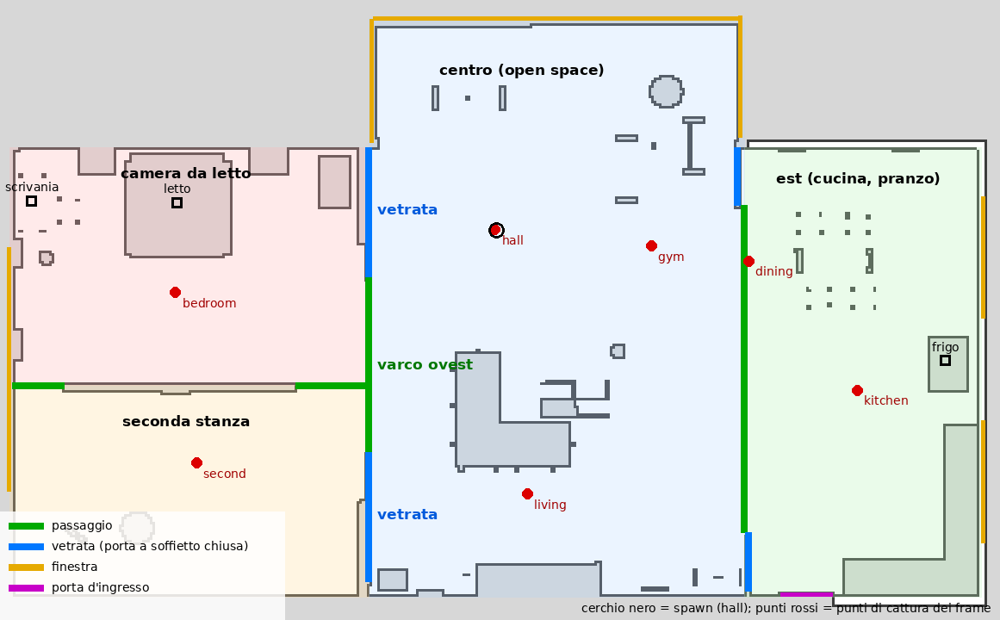
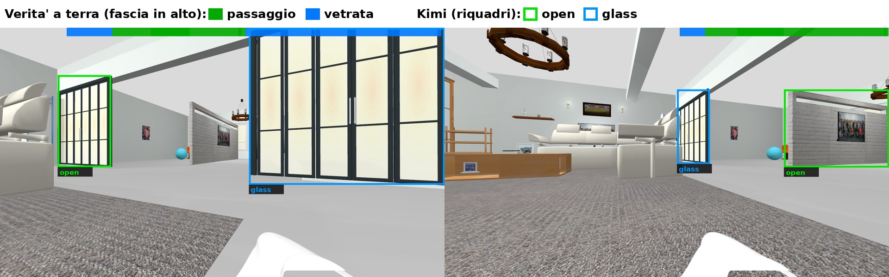
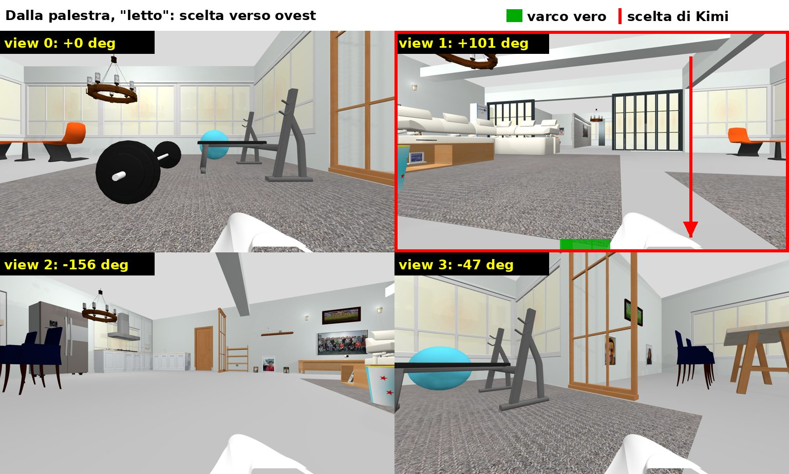
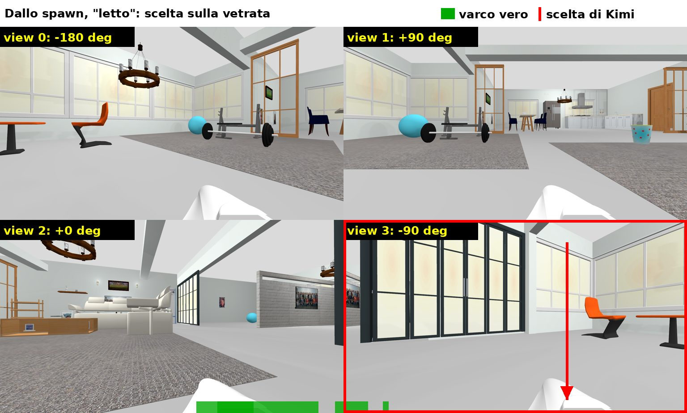
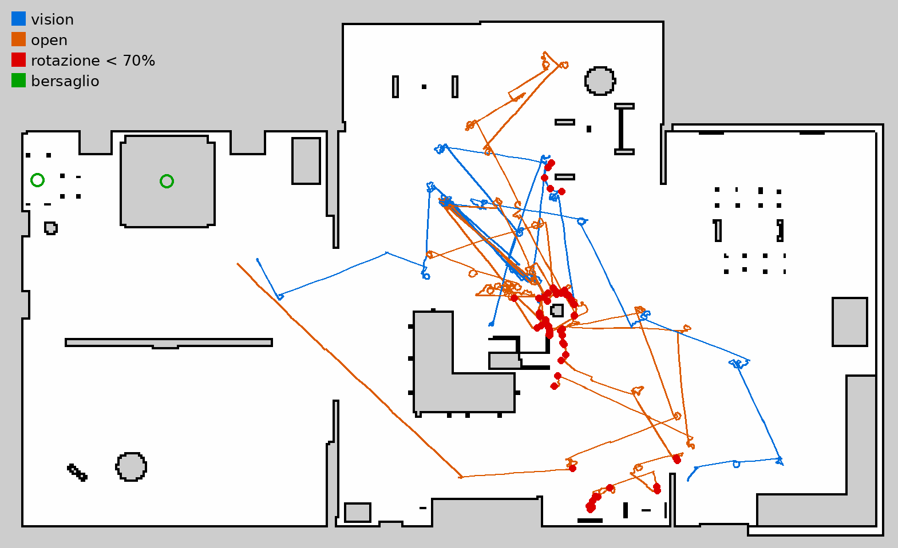
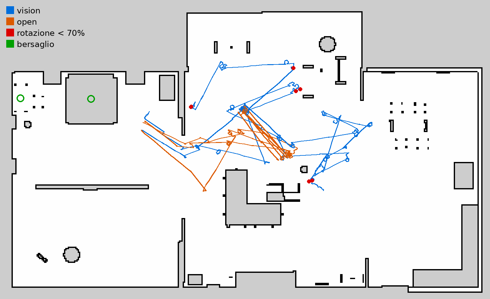

# Esplorazione senza mappa con un grafo di luoghi

Ottobre 2026. Come il robot sceglie dove andare quando non ha una mappa (`nav:=none`) e il bersaglio non è nel campo visivo: l'idea di partenza (stanze come nodi, porte come archi), cosa sa davvero vedere il modello vision, cosa è stato implementato e come si comporta nella casa simulata. Numeri grezzi e script: [`scripts/vision_eval/RISULTATI.md`](../scripts/vision_eval/RISULTATI.md).

La versione definitiva costruirà prima una mappa e poi la userà (Nav2, `nav:=map`): questa è la modalità di riserva quando la mappa non c'è.

## In breve

- **Offline Kimi sceglie la direzione meglio della regola dello spazio libero.** Dopo un giro senza bersaglio, il 58–65% delle camminate scelte da Kimi avvicina alla stanza del bersaglio, contro il 38%; per l'ala ovest 74–82% contro 21%.
- **A ciclo chiuso il vantaggio non si vede.** Nella prima serie (16 corse) letto e scrivania dallo spawn sono stati raggiunti 1 volta su 5 con entrambe le modalità; nella seconda (10 corse) 2 su 5 con `vision` e 3 su 5 con `open`. Per questo il default di `NEBIUS_EXPLORE_CHOICE` è `open`; `vision` resta disponibile.
- **Il collo di bottiglia era il corpo, non la scelta.** Vicino a oggetti bassi che la profondità frontale non vedeva (cestino, tavolino, porta-manubri) il robot si incastrava. Le rotazioni comandate a meno di 0,4 m da un ostacolo riuscivano in mediana al 40%, e la direzione stimata, che contava ogni comando come eseguito, derivava fino a 180°.
- **Correggendo il corpo il letto si raggiunge quasi sempre.** Con la direzione dall'IMU, il corridoio di profondità per gli oggetti bassi e lo sblocco delle rotazioni, il letto è arrivato in 5 corse su 6 contro 2 su 6. Le rotazioni vicino agli ostacoli sono scese da 85 a 15, e la direzione a fine corsa resta entro ±10° in 8 corse su 10. La scrivania (0 su 4) resta difficile: due volte il robot si è fermato davanti a una struttura del soggiorno che Kimi chiama "reception desk".
- **Le corse hanno fatto emergere otto difetti, tutti corretti:** due falsi arrivi sul divano, un letto perso ricentrando, la calibrazione dei movimenti sbagliata del 20%, il robot fermo davanti al telaio di una vetrata (due casi), una deviazione senza spazio per svoltare e un timeout della camera che chiudeva il compito. Resta aperto un falso arrivo semantico: il tavolino preso per una scrivania.

## Il problema

Senza mappa l'agente cerca il bersaglio con un giro sul posto (5 rotazioni da 90°). Se non lo vede, esplora: cammina fino a 2,5 m e rifà il giro da lì. Prima di questo lavoro la direzione era la porta riportata da almeno due viste del giro oppure, quasi sempre, la direzione con più spazio libero davanti. Nella casa la direzione più aperta porta quasi sempre nell'open space verso est (5–8 m liberi), mentre la camera da letto è a ovest dietro un varco. Così "vai in camera da letto" falliva in 2 corse su 2 con i passi da 45° e dipendeva dalla prima esplorazione con quelli da 90°.

## La casa vista come grafo



L'idea era: le stanze sono i nodi, le porte sono gli archi, il robot sceglie la porta che porta alla stanza del bersaglio. La casa però non è fatta così:

- **il centro e l'est sono un unico open space** (ingresso, palestra, soggiorno, zona finestre, sala da pranzo, cucina): fra le "stanze" non ci sono porte, al massimo un'apertura larga 6,3 m;
- **l'ala ovest** (camera da letto e seconda stanza, separate da un muro alto 1,9 m con due varchi alle estremità) si raggiunge da **un solo varco** largo 3,4 m (x = −2,46, y fra −2,8 e 0,59);
- ai due lati del varco ci sono **porte a soffietto di vetro, chiuse** (vetro smerigliato con telaio nero a ovest, telaio di legno a est): sembrano porte, ma non si attraversano;
- dallo spawn il letto non si vede; il varco è 3 m a sud-ovest, ai margini di due viste del giro.

I nodi utili quindi non sono stanze ma **luoghi**: i punti in cui il robot fa un giro. Gli archi sono le direzioni percorse da ciascun luogo, attraverso un varco o nello spazio aperto.

## Cosa sa vedere il modello vision (misure offline)

Sui 56 frame della casa (7 punti × 8 direzioni) con la posa reale, la topologia vera della casa ([`house_topology.json`](../scripts/vision_eval/house_topology.json)) è stata proiettata in ogni frame: quali passaggi, vetrate e finestre sono visibili, a che angolo e a che distanza. Script: `topo_eval.py` ed `explore_choice_eval.py` in `scripts/vision_eval/`.

### Porte e passaggi

| Prompt di Kimi-K2.6 | "Aperte" su un passaggio vero | Vetrate chiuse dichiarate aperte | Passaggi riportati | Latenza |
|---|---|---|---|---|
| attuale (lista di porte) | 48% | 42 | 27% | 2,49 s |
| con il tipo (aperta, vetro, chiusa) | 64% | 11 | 31% | 2,74 s |



*Dall'ingresso. A sinistra Kimi chiama "open" la vetrata sud e non riporta il varco; a destra classifica bene vetrata e varco.*

Chiedere il tipo di apertura dimezza le vetrate scambiate per porte, ma una porta "aperta" su tre non è un passaggio vero e due passaggi su tre non vengono riportati. Su un grafo di porte fatto così il robot sbaglierebbe arco spesso.

### Stanze e "cosa c'è oltre"

- **Tipo di zona**: dalla camera da letto Kimi risponde "living room" 11 volte e "bedroom" 10. Le viste verso il varco mostrano il soggiorno, e una votazione sul giro sbaglierebbe stanza.
- **Cosa c'è oltre un varco**: per il varco verso la camera visto dal centro non nomina mai camera o letto (0/9: "adjacent room with chandelier", "area beyond divider"). Dal centro, attraverso il varco, si vede solo un corridoio con un muretto di mattoni.

Etichette di stanza e "cosa c'è oltre" non sono abbastanza affidabili per decidere: non sono state adottate.

### Dove andare dopo un giro

La domanda che conta davvero è un'altra: dopo un giro senza bersaglio, **in che direzione camminare?** Per 65 casi (7 punti di cattura × bersagli che stanno solo in altre zone) è stato misurato di quanto una camminata di 2,5 m accorcia il percorso a piedi verso la zona del bersaglio (distanza geodetica sulla mappa, fermandosi a 0,45 m dagli ostacoli, vetrate comprese).

| Chi sceglie | Avvicinano > 0,5 m | Allontanano > 0,5 m | Progresso medio |
|---|---|---|---|
| **Kimi, sul mosaico delle viste del giro: vista + punto** | **58–65%** | **8–12%** | **+0,83…+1,04 m** |
| Kimi, elencando prima le aperture di ogni vista | 65% | 20% | +0,88 m |
| Nemotron, sulle descrizioni testuali delle viste | 25% | 22% | −0,14 m |
| la vista con una porta "aperta" | 34% | 29% | −0,07 m |
| la direzione più aperta (regola precedente) | 38% | 42% | −0,16 m |
| una vista a caso | — | — | −0,25 m |

Per i bersagli dell'ala ovest (letto, armadio, comodino, scrivania) Kimi avvicina nel 74–82% dei casi contro il 21% della direzione più aperta; per quelli dell'open space la direzione più aperta resta migliore (63% contro 37–41%), ma lì il bersaglio di solito si vede già durante il giro.



*Dalla palestra, bersaglio "letto": Kimi sceglie la vista verso il varco ovest (fascia verde) e un punto poco a destra.*



*Dallo spawn, bersaglio "letto": Kimi sceglie la vetrata (vista 3). Il varco vero è a destra nella vista 2, accanto al muretto di mattoni.*

Il punto debole è proprio lo spawn: con le 4 viste del giro del robot e 6 ripetizioni, per letto, armadio e scrivania Kimi non sceglie mai la direzione giusta (0/6: porte a vetri con telaio di legno, prese per porte di camere, oppure la cucina), mentre per il frigorifero la indovina sempre (6/6). Dire nel prompt che le vetrate non si attraversano, o di preferire le zone che non si vedono, non cambia nulla; nemmeno farle elencare prima di scegliere.

## Cosa è stato implementato

### Grafo dei luoghi (`policy.ts`)

- **Posizione stimata** (`xM`, `yM`): somma degli avanzamenti eseguiti lungo la direzione stimata. Niente posa reale e niente odometria: in simulazione `/map` è la posa di Gazebo e non va passata all'agente.
- **Luoghi** (`places`): un nodo per ogni punto in cui il robot finisce un giro senza bersaglio; un giro entro 1,5 m da un luogo noto è lo stesso luogo (`enterPlace`).
- **Archi esplorati** (`exploredDeg`): le direzioni già prese da quel luogo e la direzione opposta a quella da cui il robot è arrivato.
- **Direzione suggerita** (`suggestedHeadingDeg`): se c'è e non è bloccata, `chooseExploreHeading` la usa prima delle porte e dello spazio libero. Dopo un viaggio Nav2 (`nav:=slam`) posizione e grafo ripartono da zero.

### Scelta della direzione (`perception.ts`, `agent.ts`)

Alla fine di ogni giro senza bersaglio, `suggestExploration` compone le viste del giro (l'ultima per ogni direzione, 768×432 ciascuna) in un'unica immagine, etichetta ognuna con numero, direzione rispetto al robot ed "(explored)" se punta verso un arco già esplorato, e chiede a Kimi (`chooseExploreView`, JSON strutturato) la vista e il punto `x` verso cui camminare. La direzione è quella della vista più l'angolo di `x` nella camera. Costa una chiamata in più per giro (~2 s); se la risposta manca o non è valida, si usano porte e spazio libero come prima.

Log: `[Graph] place 2 of 2 at (1.8, -1.7) m, explored headings [136] deg` e `[Explore] vision model: view 3 (0 deg), x 0.85 -> heading -148 deg ...: <motivo>`.

Si attiva con `NEBIUS_EXPLORE_CHOICE=vision`, solo con un modello vision a box (Kimi-K2.6); un modello a colonne (MiniCPM-V) non sa indicare un varco. Il default è `open`, la regola precedente: nelle prove a ciclo chiuso, più sotto, la scelta di Kimi non ha portato più arrivi e costa una chiamata in più per giro.

### Calibrazione dei movimenti (`run_nebius_agent.sh`)

Le direzioni delle viste e del grafo sono stimate dai movimenti comandati, quindi la calibrazione conta. Misurata con la diagnostica `AGENTICROS_DEBUG_POSE_TOPIC` (solo log), la sim attuale con le efficienze 0,65 / 0,7 girava e camminava circa il 20% più del comandato: −90° comandati diventavano −106°, quindi la direzione stimata derivava di ~16° a ogni rotazione da 90°.

| Efficienze | −90° | −45° | +20° | 1 m | 0,5 m |
|---|---|---|---|---|---|
| 0,65 / 0,7 (prima) | −106° | −54° | +25° | 1,20 m | 0,59 m |
| **0,77 / 0,84** (ora) | −91…−93° | −46° | +18° | 0,97 m | 0,51 m |

Misure headless con real time factor 1,0. I comandi sono temporizzati in secondi reali: se la sim gira più lenta (per esempio con la GUI), le due efficienze vanno moltiplicate per il real time factor (`gz topic -e -n 1 -t /stats`).

### Guardia: avvistamento che parte già vicino

In una prova, esplorando, il robot è finito a 0,37 m dal divano bianco ad angolo: il riquadro riempiva il 90% dell'immagine e sia Kimi sia la verifica sul ritaglio l'hanno preso per un letto ("imbottitura con cuscini"), due frame di fila, arrivo dichiarato a 7,4 m dal letto vero. Ora un avvistamento che **comincia** già alla distanza d'arrivo (≤ 1,35 m) con il riquadro alto almeno il 60% dell'immagine non viene confermato dalla sola ripetizione (`closeFirstSighting`): il robot continua a cercare, come già fa con un avvistamento non confermato davanti a un ostacolo. Non vale se il bersaglio era stato visto più lontano nella stessa direzione (±25°) nelle ultime 3 osservazioni: è la fine di un avvicinamento con un frame mancato.

Nella serie A/B la guardia è stata aggirata una volta. Il divano, visto per la prima volta con il riquadro alto il 70% dell'immagine, aveva distanza ignota, perché la profondità leggeva un cuscino più vicino del riquadro. Al frame dopo era a 0,77 m ed è stato confermato come letto. Ora anche un primo avvistamento a distanza ignota che riempie l'immagine conta come "già vicino".

### Avvicinamento: niente ricentraggi inutili

In una corsa il robot, arrivato nel soggiorno, ha visto e confermato il letto attraverso il varco a 7,4 m, 5,5° a destra. Nemotron ha chiesto due volte `face_target` (rotazioni di 5°) invece di avvicinarsi; al terzo frame Kimi non ha visto il letto, piccolo e lontano, e il robot ha ricominciato il giro perdendolo. Ora `face_target` entro la tolleranza di allineamento (12°) viene rifiutato con l'indicazione di usare `approach_target`, che allinea e avanza da solo (1 m quando il bersaglio è lontano).

### Bloccato contro uno spigolo: la deviazione

In due corse, una per modalità, il robot è arrivato al varco giusto, ma la linea retta verso il letto passava sullo spigolo della porta a soffietto nord. Con il fianco contro il telaio non riusciva né a girare né ad avanzare, mentre la profondità vedeva spazio libero oltre il varco: in una corsa è rimasto lì 45 passi, a 0,26 m dalla vetrata e a 4,3 m dal letto.

Ora il controller confronta ogni movimento con l'immagine successiva (`lastMotion`, `ineffectiveMotions`):

- dopo una rotazione di almeno 8° il bersaglio deve spostarsi nell'immagine di almeno il 35% della rotazione;
- dopo un avanzamento di almeno 0,5 m deve avvicinarsi o cambiare direzione.

Due movimenti di fila senza effetto significano che il corpo è bloccato. Il robot allora gira di 40° dal lato opposto al bersaglio, dove di solito sta lo spigolo contro cui ha cercato di girare, avanza fino a 0,7 m se c'è spazio e riprende l'avvicinamento (`detour`, log `[Decision] … (stuck: turning left to go around the obstacle)`). Funziona solo con il bersaglio visibile, perché è il bersaglio a dire se il movimento è avvenuto.

In una prova successiva, partita davanti al telaio, è emerso il caso opposto: i movimenti funzionavano, ma a 0,48 m dal telaio non c'era più spazio per avanzare. Il letto era confermato a 3,2 m, a +10°, e il robot si è arreso con "Il percorso verso il bersaglio è bloccato.", mentre il varco libero era 60° più a sinistra. Ora, con il bersaglio confermato, centrato e non ancora raggiunto, e senza spazio per avanzare, il robot gira e cammina come sopra, prima **dal lato del bersaglio** e, se si blocca di nuovo, dall'altro (log `(blocked: …)`). Qui girare dal lato opposto lo avrebbe portato contro la vetrata. Si arrende solo dopo 3 deviazioni dallo stesso punto. Un avvistamento non confermato davanti a un ostacolo resta escluso: come prima, il robot continua a cercare (la guardia del divano).

Nella serie A/B la deviazione è scattata davanti a un divano, ma dopo la svolta di 40° il divano era ancora a 0,43 m e la corsa è finita con "Nessuna azione sicura disponibile.". Ora, se dopo la svolta non c'è spazio per camminare, il robot gira subito di 80° dall'altro lato. Finite le deviazioni, il messaggio è "Il percorso verso il bersaglio è bloccato.".

### Camera: un timeout non interrompe più il compito

In una corsa uno snapshot della camera è andato in timeout al passo 57 e l'errore ha chiuso l'intero compito. Ora conta come un'osservazione mancata: nessun movimento, si riprova, e il compito si interrompe solo dopo 3 fallimenti di fila, come già accade se non risponde il modello vision.

### Cosa non è stato adottato

- il tipo di apertura nel prompt di ogni passo (+10% di latenza, bersagli trovati 83% contro 86%, non significativo) e il grafo di porte costruito su di esso: troppi errori sugli archi;
- tipo di zona e "cosa c'è oltre": non affidabili (vedi sopra);
- la scelta di Nemotron sulle descrizioni testuali: appena meglio del caso (vista giusta 32–34% contro 28%).

## Prove a ciclo chiuso

Serie A/B del 13 ottobre 2026. Casa simulata headless, `nav:=none`, real time factor 1,0, codice con guardie, deviazione e snapshot robusto (prima delle due correzioni nate dalla serie stessa). 16 corse alternate fra `vision` e `open`, limite di 80 passi e 600 s. L'arrivo è verificato sulla posa reale di Gazebo, registrata fuori dall'agente insieme alla traiettoria.

| Missione (partenza) | `vision` | `open` |
|---|---|---|
| letto, dallo spawn | **1 su 3**: arrivato in 56 passi; fallito a est dopo 7 esplorazioni; falso arrivo sul divano | **1 su 3**: arrivato in 63 passi; 2 volte 80 passi senza uscire dal soggiorno |
| scrivania, dallo spawn | **0 su 2**: falso arrivo sul tavolino, preso per "reception desk"; tempo esaurito a est | **0 su 2**: 7 e 6 esplorazioni fra centro ed est |
| frigorifero, dalla camera | 2 su 3 (19 e 25 passi); 1 fermata davanti al divano | 3 su 3 (26–31 passi) |
| **missioni con esplorazione** | **1 su 5** | **1 su 5** |

Il frigorifero si vede già durante il primo giro, quindi quelle corse non esplorano e non dicono nulla sulla scelta della direzione.



*Traiettorie vere delle 9 corse con esplorazione registrate (la prima è partita prima del registratore): `vision` in blu, `open` in arancione. I punti rossi sono le rotazioni che hanno girato meno del 70% del comando.*

Cosa mostrano le corse:

- **L'ala ovest è stata raggiunta 1 volta per modalità.** Dallo spawn Kimi ha mandato il robot a est o al centro, come nelle misure offline (0/6 per letto, armadio e scrivania). La regola dello spazio libero porta quasi sempre nell'open space.
- **Le rotazioni falliscono vicino agli oggetti bassi.** Su 330 rotazioni comandate di almeno 60°, ecco la frazione girata davvero, in base alla distanza del centro del robot dall'ostacolo più vicino della mappa:

  | Distanza dall'ostacolo | Rotazioni | Girato (mediana) | Sotto il 70% |
  |---|---|---|---|
  | < 0,4 m | 85 | 40% | 61 |
  | 0,4–0,8 m | 56 | 97% | 5 |
  | 0,8–1,2 m | 87 | 97% | 9 |
  | > 1,2 m | 102 | 97% | 0 |

  Gli oggetti sono il cestino del soggiorno, il tavolino, i mobili bassi contro la parete sud e il porta-manubri della palestra (0,4 × 1,4 m, alto 0,4 m, appena più della camera), che non compare nemmeno nella mappa (i 9 casi fra 0,8 e 1,2 m). Il corridoio di profondità davanti al robot guarda sopra l'orizzonte e non li vede, quindi il robot ci cammina contro e poi non riesce a girare.
- **La direzione stimata deriva con le rotazioni fallite.** In 3 corse su 9, alla fine, la direzione stimata differiva da quella vera di più di 140°; nelle corse `vision` la posizione stimata dei luoghi sbagliava fino a 3,2 m in una e fino a 10 m in un'altra. Con una deriva così le direzioni "già esplorate" e il riconoscimento dei luoghi non corrispondono più alla casa.
- **Falsi arrivi**: 2 corse `vision` su 8 sono finite su un oggetto sbagliato (divano per letto, tavolino per scrivania). Il primo è corretto dalla guardia estesa; il secondo è un errore semantico del modello vision, confermato anche dalla verifica sul ritaglio, e resta aperto.

Le prove singole allo spigolo fatte prima della serie, partendo a 0,5–1,7 m dal varco ovest, sono arrivate al letto 3 volte su 4 (2,23–2,40 m dal centro del letto, cioè sul bordo). La quarta si è arresa davanti al telaio e ha portato alla deviazione per percorso bloccato.

## Dopo la serie A/B: il corpo e la verifica

La serie A/B ha indicato dove intervenire: la direzione stimata, gli oggetti bassi, le rotazioni bloccate e i falsi arrivi. Ecco le quattro modifiche, ognuna misurata.

### Direzione dall'IMU (`imu-yaw.ts`, `policy.ts`)

- Il server MCP integra la velocità angolare del giroscopio della camera ZED (`/dottorcane/slam/zed_x_driver/imu`, tool `ros2_imu_yaw`). L'orientamento serve solo per roll e pitch, cioè per proiettare la velocità sulla verticale. L'agente legge la direzione con ogni fotogramma e sostituisce la rotazione comandata con quella misurata, sia nella direzione stimata sia nei gradi del giro (`applyImuYaw`, log `[Heading] IMU: turned -41 deg, commanded -90 deg`).
- In simulazione l'IMU non ha rumore e il suo orientamento coincide con la posa vera di Gazebo. Per questo si usa solo la velocità angolare, come con un IMU reale. La simulazione resta comunque ottimista: il giroscopio non ha bias.
- La prima versione perdeva messaggi. Mentre il server convertiva il fotogramma della camera, la coda teneva solo gli ultimi 10 messaggi (0,1 s a 100 Hz), e la rotazione di assestamento dopo ogni movimento veniva integrata male. `imu_check.sh` fa 8 rotazioni da −90°, ognuna seguita da fotogramma, profondità e corridoio:

  | Coda dell'IMU | Differenza dalla verità a robot fermo, su ~720° |
  |---|---|
  | 10 messaggi (default) | da −5° a **+27°**, oscillante |
  | 500 messaggi | fra −3° e −8°; in una seconda prova, dopo un riavvio della sim, fra −2° e +9° |

  Ora il transport locale rispetta `queueLength` e l'IMU usa una coda di 500. Resta un difetto che non ho spiegato: nella seconda prova, a robot fermo, l'IMU ha aggiunto +8° mentre la posa vera non cambiava. Per l'esplorazione un errore di ±10° dopo otto rotazioni va bene: senza IMU arrivava a 180°. Con `NEBIUS_IMU_TOPIC=` (vuoto) si torna alla somma dei comandi.

### Ostacoli bassi: il corridoio (`depth.ts`, `agent.ts`)

- `ros2_depth_corridor` ricava il punto 3D di ogni pixel di profondità (camera orizzontale a 0,385 m da terra, profondità planare). Tiene i punti davanti al corpo (±0,25 m di lato), fra 5 cm e 1 m da terra e più lontani di 0,3 m: in basso nell'immagine si vedono le zampe anteriori, a 0,10–0,15 m. Il 25° punto più vicino è l'ostacolo. Lo spazio libero davanti diventa il minimo fra la fascia sopra l'orizzonte e il corridoio (log `[Perception] obstacle in the corridor at 0.72 m (band above the horizon: 6.71 m)`). Si disattiva con `NEBIUS_DEPTH_CORRIDOR=off`.
- Offline (`corridor_eval.py`) l'ho misurato su 63 frame della casa, con la mappa come verità (vetrate escluse, larghezza del corpo). Su 31 frame con un ostacolo entro 2 m, la fascia lo sovrastimava di oltre 0,5 m in 5 casi, il minimo con il corridoio in 1. In un caso lo sottostima di oltre 0,5 m: un oggetto che la mappa non ha. In palestra, per esempio, la fascia dava 4,24 m liberi e il corridoio 0,84 m, con la verità a 0,75 m.

### Rotazione bloccata: come liberarsi (`policy.ts`)

Due casi visti in simulazione. Fra cestino e tavolino 6 rotazioni da −90° di fila non hanno girato affatto. Accanto al porta-manubri il robot ha ruotato attorno al suo spigolo, girando il 30–47% del comando, finché non ci è rimasto incastrato con il posteriore: due marce indietro da 0,3 m non lo hanno liberato, e sono seguite 40 rotazioni a vuoto.

Ora, se secondo l'IMU una rotazione di almeno 30° gira meno di metà del comando, il corpo sta toccando qualcosa di lato o dietro. Il robot prova in ordine queste mosse:

1. un passo avanti di 0,3 m: si allontana da ciò che tocca, verso dove la profondità vede (se davanti non c'è spazio, indietro);
2. 45° nel verso opposto;
3. di nuovo avanti;
4. indietro;
5. di nuovo nel verso opposto.

Dopo il primo tentativo il giro di ricerca continua nel verso opposto, scelto dal controllore anche se Nemotron chiede l'altro. Se il robot è ancora bloccato dopo le 5 mosse, si ferma: "Il robot è bloccato: non riesce a girare e i tentativi di liberarsi non sono bastati." (log `rotation blocked (IMU), unstick 1/5: stepping forward`). In una prova con la prima versione della sequenza (che cominciava indietro), il robot è partito con il posteriore già dentro il porta-manubri: non si è mosso di più di 4 cm con nessuna mossa e si è fermato dopo 11 passi, invece di consumarne 80.

### Verifica sul ritaglio: prima il nome (`perception.ts`)

La verifica chiedeva `{"match", "reason"}`, quindi il modello rispondeva prima di ragionare. `verify_eval.py` confronta tre prompt su 176 ritagli della casa, tagliati come nell'agente intorno ai riquadri veri: ognuno chiede un bersaglio sul bersaglio stesso o su oggetti che gli somigliano.

| Prompt | Bersagli confermati | Sosia accettati | Tavoli come scrivania | Divani come letto |
|---|---|---|---|---|
| prima la risposta (precedente) | 38/45 | 46/131 | 34/49 | 6/20 |
| prima il nome | 27/45 | 10/131 | 4/49 | 4/20 |
| **prima il nome, parti incluse** | **35/45** | **19/131** | **6/49** | 8/20 |

Il prompt con il solo nome scarta troppi bersagli veri. Chiama "ottoman" o "mattress" un letto visto da vicino, che è proprio la vista dell'arrivo. Con "o una parte di esso (un materasso è parte di un letto)" ne perde 3 su 45 e dimezza i sosia accettati. Il divano bianco della simulazione, visto dal basso, resta ambiguo con ogni prompt: Kimi lo chiama anche "bunk bed".

### Seconda serie A/B

Stesse condizioni della prima serie, con le quattro modifiche sopra, su una sim rilanciata subito prima (vedi le insidie in `CLAUDE.md`). Le corse sono 10, tutte di missioni che richiedono di esplorare: il frigorifero, che si vede già dal primo giro, è stato tolto.

| Missione (partenza) | `vision` | `open` |
|---|---|---|
| letto, dallo spawn | **2 su 3**: 21 e 29 passi; una fallita con 6 esplorazioni fra centro ed est | **3 su 3**: 36–37 passi |
| scrivania, dallo spawn | 0 su 2: 7 esplorazioni senza uscire dal centro; tempo esaurito | 0 su 2: due falsi arrivi, una struttura del soggiorno chiamata "reception desk" |
| **missioni con esplorazione** | **2 su 5** (prima serie 1 su 5) | **3 su 5** (prima serie 1 su 5) |



*Traiettorie vere delle 10 corse: `vision` in blu, `open` in arancione; in rosso le 8 rotazioni che hanno girato meno del 70%.*

| | Prima serie | Seconda serie |
|---|---|---|
| letto raggiunto | 2 su 6 | **5 su 6** |
| rotazioni ≥ 60° a meno di 0,4 m da un ostacolo | 85 su 330, girato in mediana 40% | **15 su 222, 87%** |
| rotazioni sotto il 70% | 75 | **8** |
| direzione a fine corsa | oltre 140° di errore in 3 corse su 9 | entro ±10° in 8 corse su 10; +25° e +44° in due corse `vision` |
| sblocchi usati | — | in 2 corse (1 e 4 mosse); mai l'arresto per robot bloccato |

Cosa mostrano le corse:

- **Il corpo era il collo di bottiglia del letto.** Con il robot che gira davvero e una direzione stimata giusta, `open` arriva sempre, per la stessa strada: verso ovest, attraverso il varco. `vision` arriva prima quando Kimi sceglie bene (21 e 29 passi), ma dallo spawn a volte sceglie est, come nelle misure offline.
- **La scelta di Kimi non batte ancora lo spazio libero**: 2 su 5 contro 3 su 5. Con tre corse per casella la differenza non è significativa, ma non c'è motivo di cambiare il default.
- **La scrivania** sta in fondo alla camera, contro la finestra. Con `open` il robot non ci arriva mai, perché in 12–14 passi si ferma davanti a una struttura del soggiorno che Kimi e la verifica chiamano "reception desk": è uno dei 6 tavoli su 49 che la verifica con il nome prima accetta ancora. Con `vision` resta nel centro.
- **La direzione dall'IMU** resta entro ±10° nella maggior parte delle corse. In una (+44°) l'IMU ha misurato circa il 3–5% in meno su ogni rotazione, uno scarto troppo piccolo per comparire nei log ma che si accumula.

## Limiti

- **Lo spawn della casa** resta il caso peggiore per la scelta di Kimi: le porte a vetri con telaio di legno sembrano porte di camere, e il varco vero è ai margini di due viste.
- **Falsi positivi semantici**: un tavolino o una struttura del soggiorno presi per una scrivania ("reception desk"), il divano bianco preso per un letto. La verifica con il nome prima li riduce, ma non li elimina.
- **L'IMU simulato è ideale**: niente rumore né bias, quindi un IMU vero deriverà di più. Anche così l'integrazione nel server MCP sbaglia di qualche grado per rotazione in alcune corse (fino a +44° a fine corsa); la causa non è chiara.
- **Il corridoio vede solo davanti**: durante una rotazione fianchi e posteriore spazzano un cerchio di ~0,4 m che la camera non vede. Lo sblocco interviene dopo, quando la rotazione non riesce.
- **La marcia indietro è cieca**: nessun sensore dietro, quindi solo 0,3 m alla volta, e solo dopo un passo avanti o una svolta.
- **Il vetro**: la profondità simulata vede attraverso le vetrate (ma non i telai), quindi una stanza dietro il vetro sembra raggiungibile; il letto visto attraverso una vetrata attira il robot contro il vetro.
- **Il modello vision non è deterministico**: anche a temperatura 0 la stessa domanda può dare scelte diverse.
- **Pochi numeri**: 3 corse per casella bastano a vedere un effetto grande (letto da 2 su 6 a 5 su 6), non a distinguere `vision` da `open`.
- Con `nav:=map` tutto questo non serve: Nav2 porta il robot nella stanza giusta al primo colpo.

## Come ripetere le misure

```bash
cd ~/workspace/scripts/vision_eval
# aperture e zone sui 56 frame (servono frame e verità a terra locali, vedi README)
../../.venv/bin/python eval_vlm.py kimi26_exits_1024
../../.venv/bin/python topo_eval.py kimi26_final_1024 kimi26_exits_1024
# dove esplorare dopo un giro (65 casi)
../../.venv/bin/python explore_choice_eval.py kimi26_exits_1024
# confronto A/B a ciclo chiuso (sim della casa headless, nav:=none); registra anche la posa vera
bash -ic './closed_loop_matrix.sh spec.txt'
# traiettorie, deriva del grafo, rotazioni rispetto agli ostacoli, figura
../../.venv/bin/python closed_loop_traj.py spec.txt --rotations --plot traiettorie.png
# corridoio contro fascia sopra l'orizzonte (63 frame), verifica sul ritaglio (176 ritagli)
../../.venv/bin/python corridor_eval.py
../../.venv/bin/python verify_eval.py
# direzione dall'IMU contro la posa vera, attraverso il server MCP (sim in esecuzione)
bash -ic './imu_check.sh'
```
